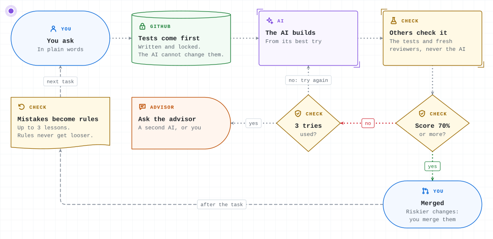

# Tollgate

<picture>
  <source media="(prefers-color-scheme: dark)" srcset="docs/diagrams/hero-dark.svg">
  
</picture>

Tollgate lets an AI write your code, and merges only what works.

It is a plugin for Claude Code, plus one GitHub workflow. You ask for a change in plain words. Tollgate plans it and cuts it into small tickets. For each ticket, it writes the tests first and locks them, has the AI build until the tests pass and the score reaches 70%, and opens a pull request.

The website: https://tollgate-ai.github.io/ (its source is in [tollgate-ai.github.io](https://github.com/tollgate-ai/tollgate-ai.github.io)).

## Why it exists

An AI that writes code makes four kinds of mistake. It invents things: a function, a file, a fact. It pads its work. It stops before the work is done. It weakens a test to make the test pass. Telling it not to does not stop these mistakes. A review by the same AI does not stop them either, because it defends its own work.

Tollgate does not ask the AI to behave. It makes these mistakes fail.

## The principles

1. **Tests come first.** Before the AI writes any code, Tollgate writes tests for what you asked for and locks them. The AI cannot change them.
2. **The AI never grades its own work.** The locked tests and fresh reviewers check each try. Each reviewer is a separate AI session that cannot edit.
3. **Every try gets a score.** 70% or more passes. A failed must-have item always fails.
4. **Each try builds on the best one.** When a try fails, the AI gets the reasons and tries again from its best try so far.
5. **It knows when to stop.** After 3 tries, the same failure twice, 30 minutes, or a cost limit, the AI asks the advisor: a second AI, or you.
6. **Riskier changes get more checks.** The files a change touches give it a tier from 1 to 4. You merge tiers 3 and 4 yourself.
7. **Mistakes become rules.** After each task, up to 3 lessons become stricter rules. Rules never get looser.
8. **Code enforces the rules.** A rule that is only written in a prompt does not count. The AI works in a container with no git or GitHub credentials.
9. **Plain words.** Everything is written for people to read.

<picture>
  <source media="(prefers-color-scheme: dark)" srcset="docs/diagrams/principles-dark.svg">
  
</picture>

[docs/principles.md](docs/principles.md) explains each principle: what it means, why it exists, how Tollgate does it, and where it stops.

## How it works

<picture>
  <source media="(prefers-color-scheme: dark)" srcset="docs/diagrams/how-it-works-dark.svg">
  
</picture>

Three loops send each problem back to the step that can fix it:

1. **The plan loop.** Fresh reviewers read the plan before any code exists. For each problem they find, the builder fixes it, argues against it with evidence, or asks the advisor. This repeats for up to 4 rounds.
2. **The build loop.** The gate, a program with no AI in it, checks each try on your machine. Below 70%, the builder gets the reasons and tries again from its best try. After 3 tries, the advisor decides.
3. **The learning loop.** After a task, `/tollgate:retro` turns up to 3 lessons into tickets: a new test, a new check, a new question for the reviewers, or a stricter rule.

On GitHub, the tests run again on every change, and an AI reviews tier 3 and 4 changes. With `auto_merge` on, Tollgate merges tier 1 and 2 changes itself. You merge the rest.

## Get started

You need Claude Code, Python 3.11 or later, git, and the `gh` command.

There is little to install and nothing to run: one workflow file, one settings file, and Python's standard library.

```
/plugin marketplace add tollgate-ai/tollgate
/plugin install tollgate@tollgate-ai
```

Then, inside your project:

```
/tollgate:init
```

`init` checks your rights on GitHub. It writes `.tollgate/settings.json` and `.github/workflows/tollgate.yml`. Then it protects the main branch and the tags.

To run tasks on GitHub instead of your machine, add one of these repository secrets: `CLAUDE_CODE_OAUTH_TOKEN` (get it with `claude setup-token`), or `ANTHROPIC_API_KEY`.

## Use it

| You type | What happens |
| --- | --- |
| `/tollgate:task` | Starts a task from your request. It runs in the background. |
| `/tollgate:status` | Shows Done and Still to do. |
| `/tollgate:inbox` | Lists what waits for your decision, across projects. |
| `/tollgate:retro` | Shows a finished task's numbers and lessons. |
| `/tollgate:home` | Keeps the plans of many projects in one private repository. |
| `/tollgate:docs` | Writes a README, docs, comments, commit messages, and pull requests in plain words. It adds a check for the writing rules. |
| `/tollgate:diagram` | Draws a diagram as an SVG file, in light and dark. |

A task runs in the background, so you can leave it running. A stopped task picks up where it stopped.

A question for you arrives as a GitHub issue with the label `tg-waiting`. You answer with a comment that starts `tollgate decide`, followed by your choice.

## Cost, and when to use it

On ten small tickets, Tollgate cost about 10 times as much as Claude Code alone, and took 2 to 4 times as long: about 0.7 USD and 3 minutes a ticket. In return, every change it opened passed its checks. We do not know yet whether it also needs fewer fixes after the merge. That is still being measured. See [the comparison](docs/experiments/e310/results.md).

Use Tollgate when an AI writes most of each change, and the change must be right. For a quick change where a mistake is cheap, use Claude Code alone. It is faster and cheaper.

## Status

Built and working:

- the gate, and the step that locks the tests,
- the driver, the program that runs each step, on your machine or on GitHub,
- the plan, review, and advisor steps,
- many projects in one home.

Still being measured: the blind review and the fixes after merge from [the comparison](docs/experiments/e310/results.md). [docs/status.md](docs/status.md) has the details.

## Read more

- [docs/principles.md](docs/principles.md): each principle in detail.
- [docs/plan.md](docs/plan.md): the design, in plain words first and in detail after.
- [docs/decisions.md](docs/decisions.md): each decision, and why.
- [CONTEXT.md](CONTEXT.md): the words this project uses, one for each thing.
- [docs/experiments/](docs/experiments/): what was tried, and what happened.

## License

Apache-2.0. See [LICENSE](LICENSE) and [NOTICE](NOTICE).
