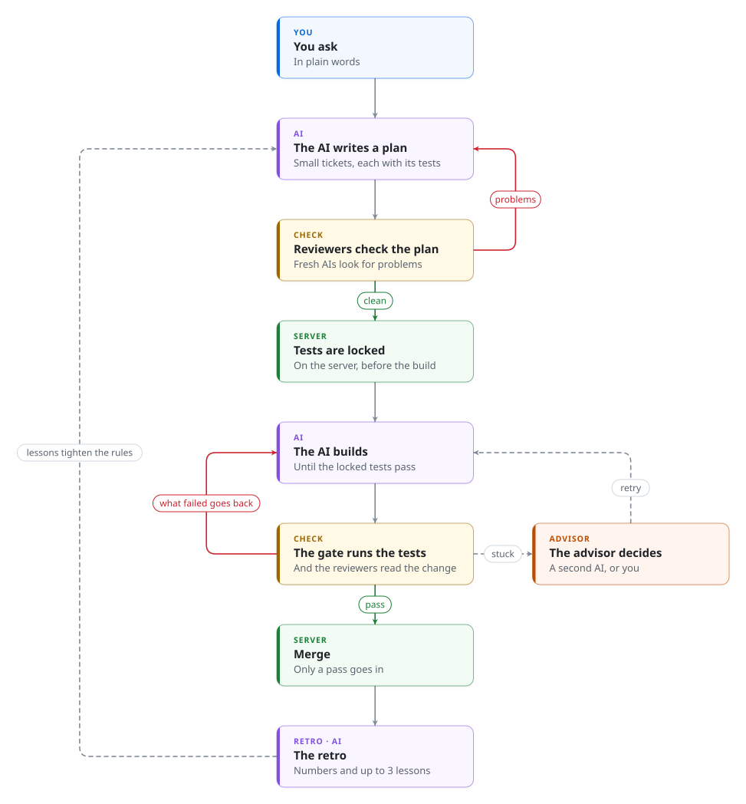

# Tollgate

<picture>
  <source media="(prefers-color-scheme: dark)" srcset="docs/diagrams/hero-dark.svg">
  
</picture>

Tollgate is a Claude Code plugin that lets an AI write your code, and merges only what works.

You ask for a change in plain words. Tollgate plans it and cuts it into small tickets. For each ticket, it writes the tests first and locks them. The AI then builds until the locked tests pass and the score reaches 70%. Everything runs on your machine. Tollgate calls no outside service except the AI model.

## Why it exists

An AI that writes code makes four kinds of mistake:

1. It invents things: a function, a file, a fact.
2. It pads its work.
3. It stops before the work is done.
4. It weakens a test to make the test pass.

Telling it not to does not stop these mistakes. A review by the same AI does not stop them either, because it defends its own work. Tollgate does not ask the AI to behave. It makes these mistakes fail.

## The principles

Tollgate keeps 18 rules, in 8 groups.

1. **Plan first.** An analyst reads the project first, and each fact cites the code or is marked assumed. Fresh reviewers check the plan, for up to 4 rounds, before any code. An assumption the plan cannot settle waits for the advisor. A large request starts with the base, then one thin path, then one feature at a time. Each ticket has a checklist, and a must-have item cannot fail.
2. **Tests first.** The test writer writes one test for each must-have item, and the store locks it before any code. The AI cannot change a locked test.
3. **Build from the best try.** Below 70%, the AI gets the reasons and tries again from its best try so far.
4. **The gate judges.** The gate is a program with no AI. It checks every try, and the AI never grades its own work. The score is the share of checklist items that pass. 70% passes. A failed must-have item fails the try. From tier 2, a reviewer reads each change, and at the end the whole task. A finding must point to a line in the change. Only the gate says a try is done.
5. **Stop when stuck.** After 3 tries, or the same failure twice, the advisor decides: a second AI, or you. The advisor also decides at each checkpoint: after the plan and after the whole task, by default.
6. **Risk sets the checks.** The files a change touches give it a tier from 1 to 4. You merge tiers 3 and 4.
7. **Mistakes become rules.** A task gives at most 3 lessons. Rules never get looser.
8. **Always.** Code enforces the rules. Every word is plain, for people. Docs move with the code, in the same change.

Each number on the picture marks the part where that rule holds.

<picture>
  <source media="(prefers-color-scheme: dark)" srcset="docs/diagrams/how-it-works-dark.svg">
  
</picture>

[docs/principles.md](docs/principles.md) explains each rule: what it means, why, how Tollgate does it, and where it stops.

## How it works

In the picture above, three loops send each problem back to the step that can fix it:

1. **The plan loop.** The analyst reads the project, then three reviewers read the plan and the analysis before any code exists. For each finding, the builder fixes it, argues against it with evidence, or asks the advisor. This repeats for up to 4 rounds. Then the advisor approves the plan, and the store signs a plan lock.
2. **The build loop.** The gate checks each try. Below 70%, the builder gets the reasons and tries again from its best try. After 3 tries, the advisor decides.
3. **The learning loop.** After a task, `/tollgate:retro` turns up to 3 lessons into tickets: a new test, a new check, a new question for the reviewers, or a stricter rule.

**The store and the state folder.** The store keeps every record in a state folder outside the project, such as `~/.local/state/tollgate/<project>/`. No role can write there. The store signs each lock and each pass record with your machine key. It checks each signature against `signers` in the settings on main, never in the change. It merges a ready change into main with a merge commit, and only when the change has a pass record. A tier 3 or 4 change also needs your approval, signed with your own SSH key.

**Two layers enforce the rules.**

<picture>
  <source media="(prefers-color-scheme: dark)" srcset="docs/diagrams/two-layers-dark.svg">
  
</picture>

1. **Claude Code hooks and policies.** Each role runs with a policy: permission rules that deny an edit of a locked file, of the settings, of the key folder, and of the state folder outside the role's copy. A hook checks each tool call again, and refuses a merge into main and `--no-verify`. A role never pushes. The plugin's hook guards your own session too: you may push a branch for review, but never main. A Tollgate subagent gets its role's rules from its subagent type.
2. **pre-commit.** In git, pre-commit runs Tollgate's checks before each commit, merge, and push. A commit may not change a locked file. A merge into main needs a pass record, and an approval for tier 3 and 4. A push to main needs the same for each merge on it.

The gate and the signed records are the real checks. They hold even when a role gets past its hook.

**The limit.** A person who skips the checks with `git commit --no-verify` or `git push --no-verify` can still change main. Tollgate does not stop you from changing your own project by hand.

## Get started

You need:

- Claude Code,
- Python 3.11 or later,
- git, with `ssh-keygen`,
- pre-commit,
- Docker, only for background mode with the container isolation. You name a container image that has Claude Code in it, under `container_image` in the settings. Tollgate ships no image. Each role logs in to the model with `ANTHROPIC_API_KEY` or `CLAUDE_CODE_OAUTH_TOKEN` from your environment; these are the only variables that go into the container.

Session mode, the default, needs none of the Docker items: no Docker, no image, and no login variable, because each role runs as a subagent in your own Claude Code session.

Install the plugin:

```
/plugin marketplace add tollgate-ai/tollgate
/plugin install tollgate@tollgate-ai
```

Then, inside your project, on the branch `main`:

```
/tollgate:init
```

`init` writes `.tollgate/settings.json`, makes your machine key, and adds it to `signers`. It adds your SSH public key to `owners`. It copies the checks into `.tollgate/checks/`, writes `.pre-commit-config.yaml`, commits these files on main, and runs `pre-commit install`.

### Change the settings later

`.tollgate/settings.json` is a locked file: the locked-file check refuses any commit that changes it, so no role can loosen the rules. To change it, edit it on main and commit it yourself, in your own terminal, as `init` does:

```
git add .tollgate/settings.json
git commit --no-verify -m "chore(settings): <what you changed>"
```

Run this outside Claude Code: Tollgate's hook refuses `--no-verify` in a Claude Code session.

## Use it

| You type | What happens |
| --- | --- |
| `/tollgate:analyze` | Reads the project and reports how it is built, with a citation for each fact. It changes no file. |
| `/tollgate:task` | Runs a task from your request, one role at a time in your session, or in the background. |
| `/tollgate:status` | Shows Done and Still to do, and warns when a layer of checks is missing. |
| `/tollgate:inbox` | Lists the questions that wait for you, across projects, and records your answer. |
| `/tollgate:merge` | Lists the ready changes, shows one, asks you to sign the approval for tier 3 and 4, and merges it. |
| `/tollgate:retro` | Shows a finished task's numbers and lessons. |
| `/tollgate:home` | Keeps many projects in one git repository, with the rules they share. |
| `/tollgate:docs` | Writes a README, docs, comments, and commit messages in plain words. It adds a check for the writing rules. |
| `/tollgate:diagram` | Draws a diagram as an SVG file, in light and dark. |

### How a task runs

The driver decides each step, the gate scores each try, and the store signs and merges. Who runs each role depends on `"runner"` in the settings:

- **Session mode**, the default: your own Claude Code session runs each role as one of Tollgate's subagents. The task skill asks the driver for the next step, starts the subagent it names, and hands back its answer, until the task is done or a question waits for you. You see each step, and the roles use your own Claude Code login.
- **Background mode**: the driver starts each role as its own process, in Docker or Claude Code's sandbox, so you can close Claude Code. A roadmap always runs this way.

In a task, each ticket builds on the ready change before it, and nothing merges until a reviewer has read the whole task. If that review finds a problem, the task runs one fix round: the plan gets new tickets for the problem, is approved and locked again, and the new tickets are built. Then the tickets merge in plan order. If the review still finds a problem after the fix round, the task parks and nothing merges.

In both modes a stopped task picks up where it stopped, and a question waits in the state folder until you answer it. [docs/design.md](docs/design.md#two-ways-to-run-the-roles) has the details, and what each mode protects.

### Threat model

Session mode stops a role's mistakes and shortcuts, such as editing locked tests, skipping checks, pushing, or touching Tollgate's state, but not a role that deliberately attacks your machine, because roles and the code they write run as you and can reach your signing key. For that, use background mode, which runs roles in a container with no key. Use background mode for tier 3 and 4 work from a source you do not trust. [docs/design.md](docs/design.md#threat-model) says what each mode protects.

## Cost, and when to use it

Each task runs an analyst and a review of the whole task, and each ticket runs several AI roles: a test writer, a builder, and reviewers. So Tollgate costs more and takes longer than Claude Code alone. In background mode the stop rules cap the cost: by default, 10 USD a ticket and 60 USD a task. In session mode the cost is your session's own, so the report shows it as unknown, and each role has a limit of turns instead. Tollgate has no measured cost numbers yet.

Use Tollgate when an AI writes most of each change, and the change must be right. For a quick change where a mistake is cheap, use Claude Code alone. It is faster and cheaper.

## Status

Unit tests with fake roles cover the store, the signed records, the gate, the driver loop for a task and a ticket, a whole task in session mode with fake answers, the stop rules, the advisor, the hook, the policies that Tollgate writes, init, the pre-commit checks, merge, inbox, and home.

Untested:

- A real role obeying its policy inside Claude Code.
- The `sandbox` isolation. So the default isolation is `container`.
- A role in Docker through the driver.
- A task end to end with real models, in either mode.
- The roadmap and the retro.

The store runs the tests for a lock on your machine, not in the role's isolation.

## Read more

- [docs/principles.md](docs/principles.md): each rule in detail.
- [docs/design.md](docs/design.md): the design, in plain words first and in detail after.
- [CONTEXT.md](CONTEXT.md): the words this project uses, one for each thing.

## License

Apache-2.0. See [LICENSE](LICENSE) and [NOTICE](NOTICE).
