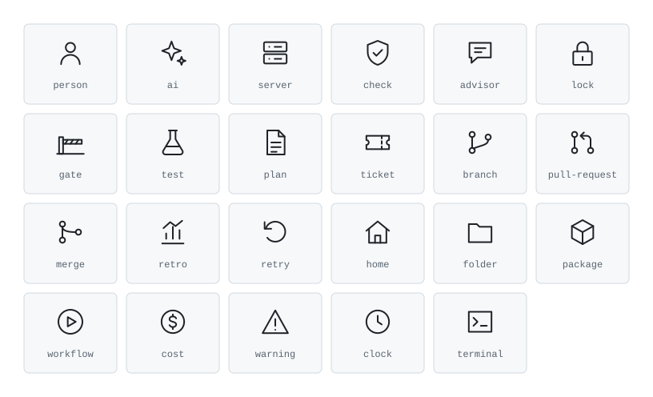

# Diagrams

Every diagram in this repo is SVG, drawn by code here, in a light and a dark file. The `diagram` skill (`skills/diagram/SKILL.md`) says how to draw one. `python3 docs/diagrams/build.py` draws them all; `--check` fails when one is out of date.

- `src/*.json`: one spec per diagram, a flow or a scene.
- `build.py`: draws them all, plus the diagrams drawn from the code (`workflow`), the banner (`hero.py`), and the icon sheet.
- The engine ships with the plugin, in `diagram/`: `flow.py` (flows and the colors), `scene.py` (scenes), `icons.py` (the icons), `aws.py` (AWS icons from the official package). Any project with the plugin draws its own diagrams with `python3 -m diagram build <folder>`.

## Shapes

A flow uses the standard flowchart shapes. Each step takes the shape of what it is.

<picture>
  <source media="(prefers-color-scheme: dark)" srcset="shapes-dark.svg">
  
</picture>

## Icons

Tollgate's own icons, drawn for this project. Use them by name in a spec (`"icon": "lock"`) or in a scene (`badge`).

<picture>
  <source media="(prefers-color-scheme: dark)" srcset="icons-dark.svg">
  
</picture>

## AWS icons

AWS's icons are not in this repo. The first AWS diagram downloads the official package from AWS into a cache on your machine, once, and a diagram copies in only the icons it uses, unchanged. AWS allows its icons in architecture diagrams. See https://aws.amazon.com/architecture/icons/ for the package and its terms.
