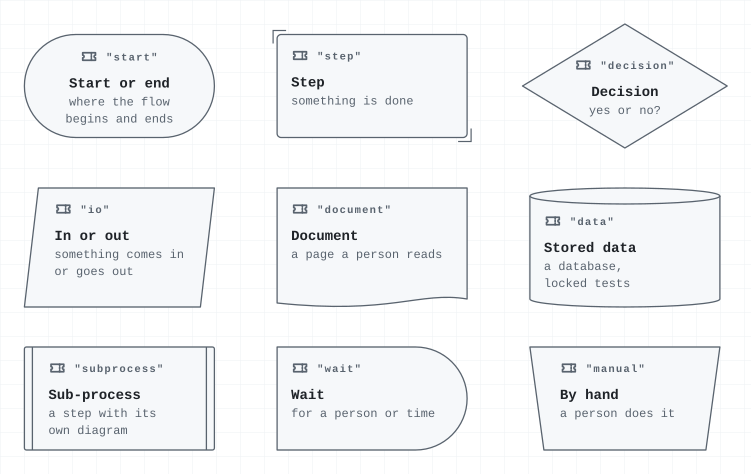
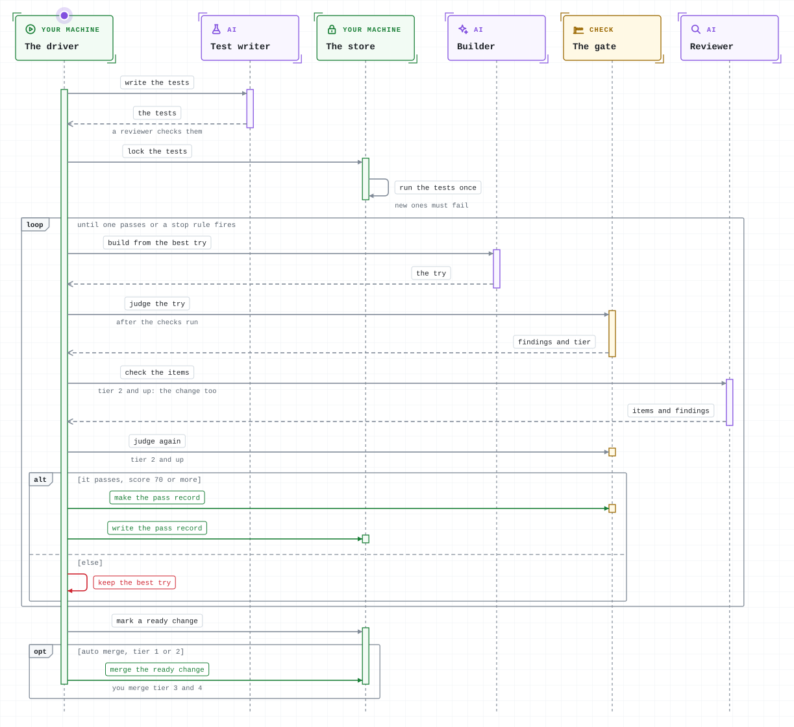
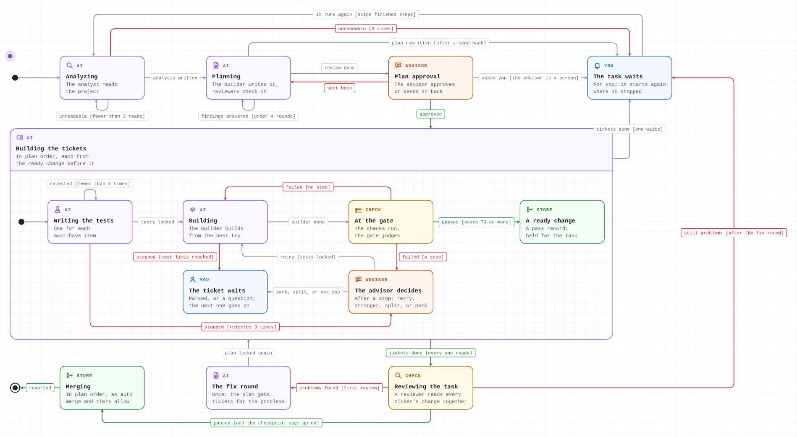
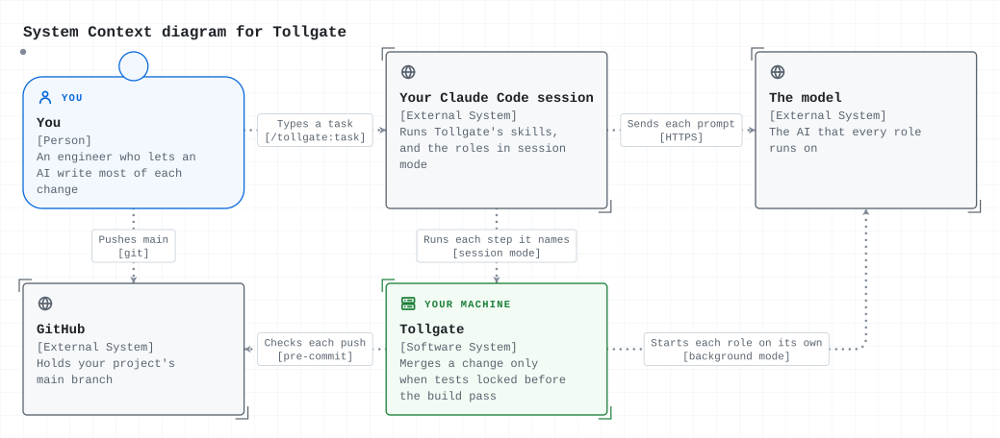
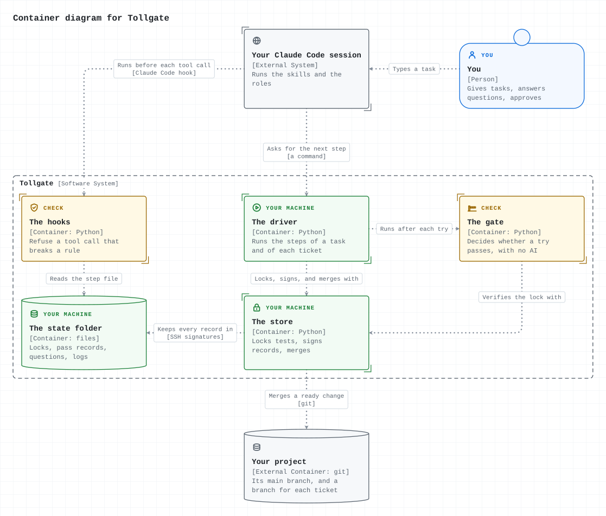
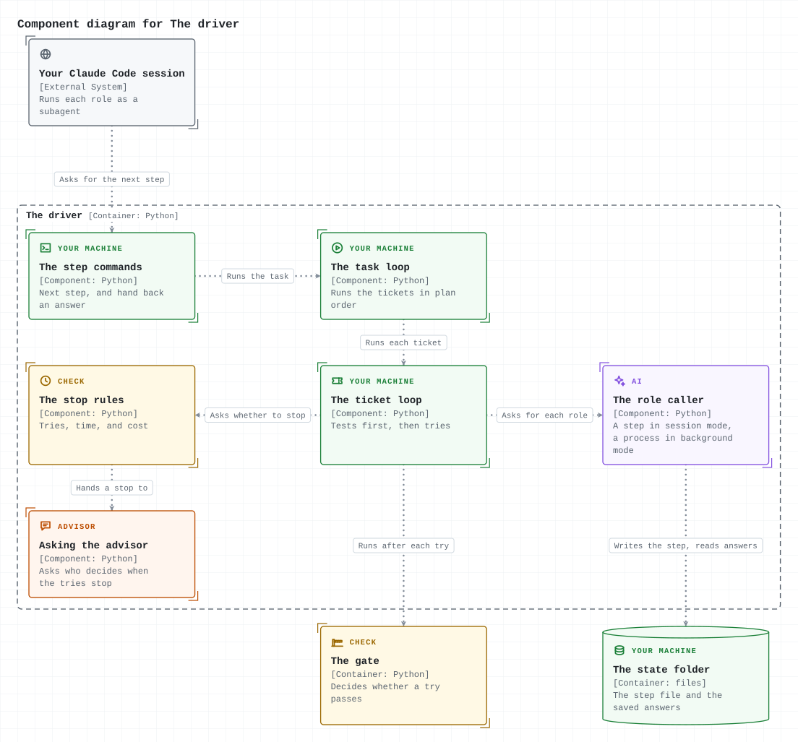
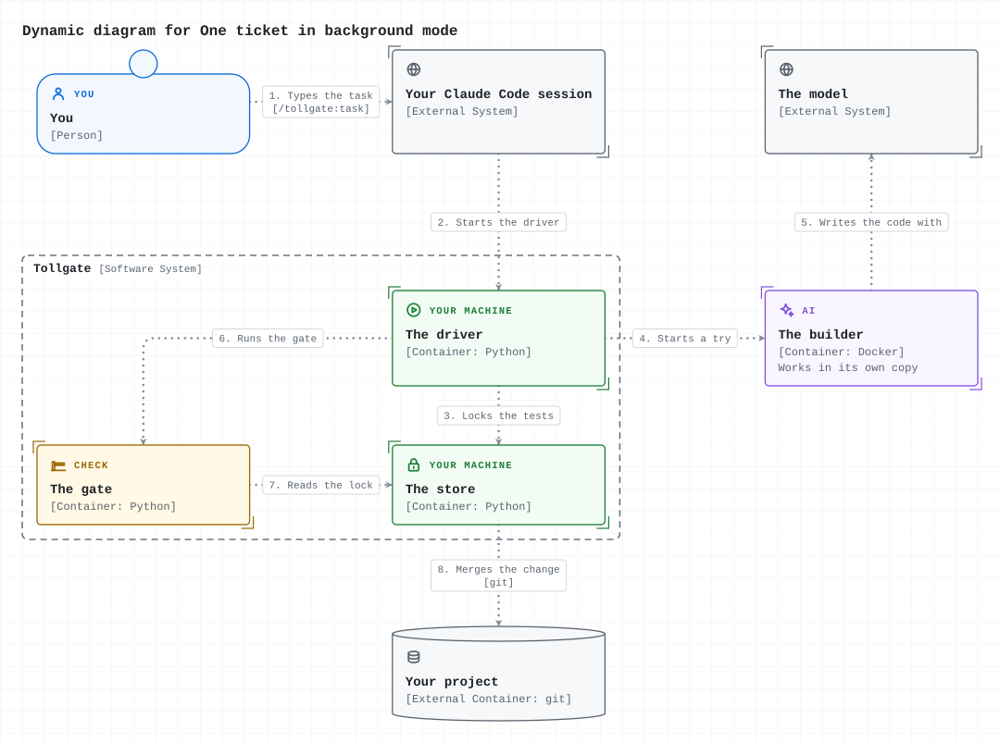
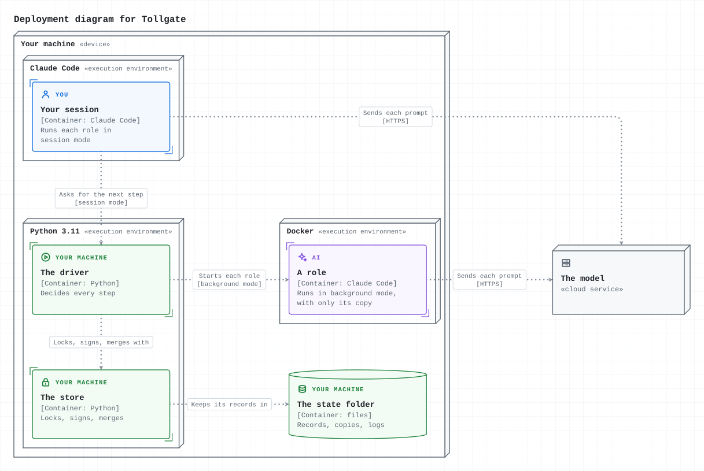
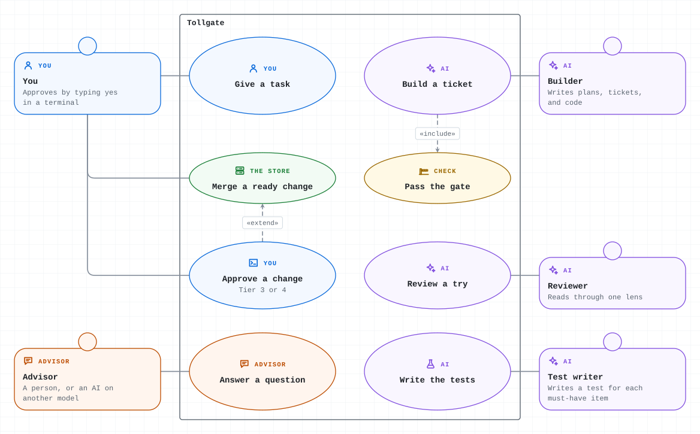

# Diagrams

Every diagram in this repo is SVG, drawn by code here, in a light and a dark file. The `diagram` skill (`skills/diagram/SKILL.md`) says how to draw one. `python3 docs/diagrams/build.py` draws them all; `--check` fails when one is out of date.

- `src/*.json`: one spec per diagram: a flow, a sequence, a state machine, a C4 diagram, a use case diagram, or a scene.
- `build.py`: draws them all, plus the diagrams drawn from the code (`workflow`), the banner (`hero.py`), and the icon sheet.
- The engine ships with the plugin, in `diagram/`: `flow.py` (flows and the colors), `sequence.py` (sequence diagrams), `state.py` (state machines), `c4.py` (C4 diagrams), `usecase.py` (use case diagrams), `scene.py` (scenes), `icons.py` (the icons), `aws.py` (AWS icons from the official package). Any project with the plugin draws its own diagrams with `python3 -m diagram build <folder>`.

## Shapes

A flow uses the standard flowchart shapes. Each step takes the shape of what it is.

<picture>
  <source media="(prefers-color-scheme: dark)" srcset="shapes-dark.svg">
  
</picture>

## Sequence and state machine

A sequence diagram shows one scenario between parts, in time order, down the page. This one is one ticket, from the driver to the store.

<picture>
  <source media="(prefers-color-scheme: dark)" srcset="one-ticket-sequence-dark.svg">
  
</picture>

A state machine shows the states one thing is in, and the events that move it between them. This one is a task's lifecycle.

<picture>
  <source media="(prefers-color-scheme: dark)" srcset="task-lifecycle-dark.svg">
  
</picture>

## C4 diagrams

A C4 diagram shows the architecture of a system at one level. These five draw Tollgate. The context: who uses Tollgate, and what it works with.

<picture>
  <source media="(prefers-color-scheme: dark)" srcset="c4-context-dark.svg">
  
</picture>

The containers: the parts Tollgate runs as, and what each one does.

<picture>
  <source media="(prefers-color-scheme: dark)" srcset="c4-container-dark.svg">
  
</picture>

The components of one container, the driver.

<picture>
  <source media="(prefers-color-scheme: dark)" srcset="c4-component-dark.svg">
  
</picture>

A dynamic diagram: one scenario as numbered steps. This one is one ticket in background mode.

<picture>
  <source media="(prefers-color-scheme: dark)" srcset="c4-dynamic-dark.svg">
  
</picture>

A deployment diagram: where each part runs, in session mode and in background mode.

<picture>
  <source media="(prefers-color-scheme: dark)" srcset="c4-deployment-dark.svg">
  
</picture>

## Use case diagram

A use case diagram shows who uses a system, and for what.

<picture>
  <source media="(prefers-color-scheme: dark)" srcset="usecase-dark.svg">
  
</picture>

## Icons

Tollgate's own icons, drawn for this project. Use them by name in a spec (`"icon": "lock"`) or in a scene (`badge`).

<picture>
  <source media="(prefers-color-scheme: dark)" srcset="icons-dark.svg">
  
</picture>

## AWS icons

AWS's icons are not in this repo. The first AWS diagram downloads the official package from AWS into a cache on your machine, once, and a diagram copies in only the icons it uses, unchanged. AWS allows its icons in architecture diagrams. See https://aws.amazon.com/architecture/icons/ for the package and its terms.
