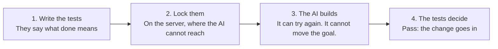
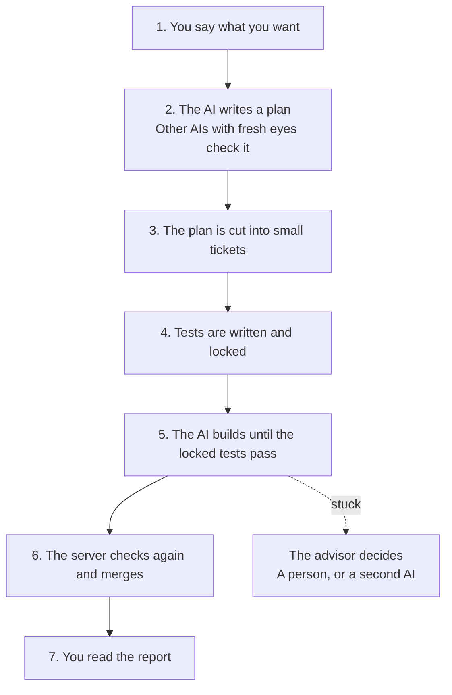
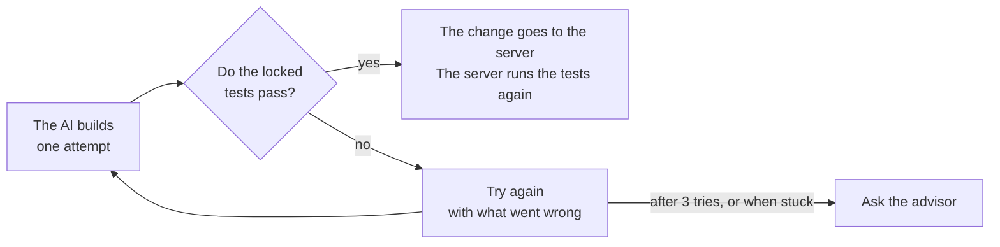
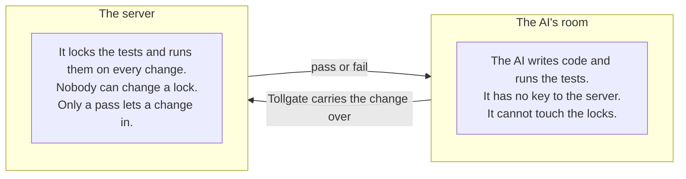
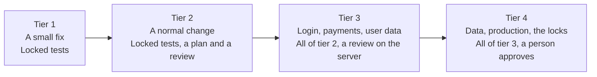
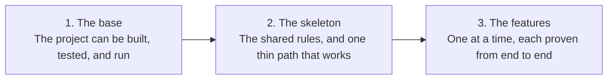
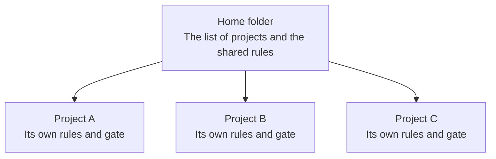
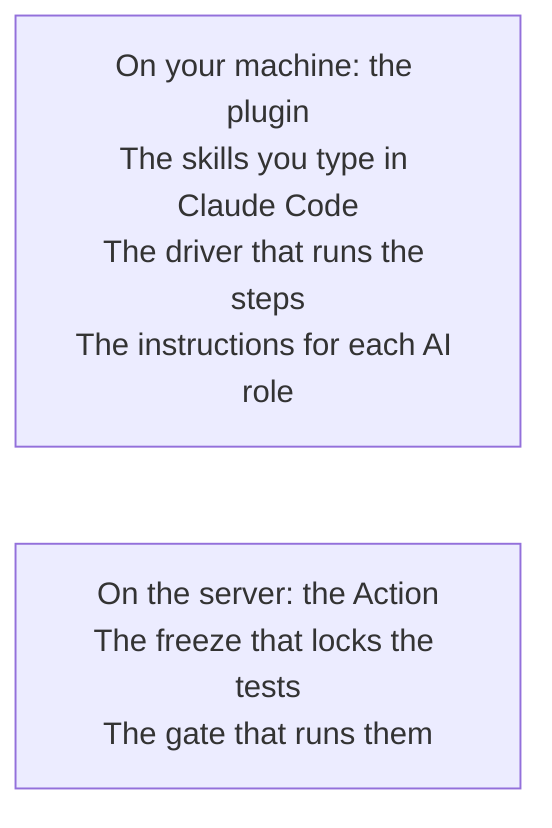
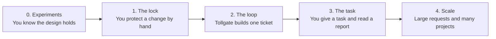

# Tollgate plan

Author: Mohamed Rekiba. Date: 2026-11-21.

## What Tollgate is

Tollgate is a tool for Claude Code. It lets an AI build a change to your software, and it keeps that change out until tests that the AI cannot change pass it.

You give Tollgate a task. Tollgate gives you merged code and a report.



Think of an exam. The questions are set and sealed before the student starts. The student can take the exam more than once, but the student cannot rewrite the questions or mark the paper.

**Who it is for.** An engineer or a small team that lets an AI write most of each change. It works on one project or on many.

**The problem.** An AI that writes code makes four kinds of mistake. It invents things: a function, a file, a fact. It pads its work. It stops before the work is done. It weakens a test to make the test pass. Written instructions do not stop these mistakes, because the AI can ignore instructions. A review by the same AI does not stop them either, because it defends its own work.

**The answer.** Tollgate does not ask the AI to behave. The server locks the tests before the AI builds, and the server runs them after.

**The limit.** Tollgate stops an AI that takes a shortcut. It does not stop code that is written to attack the test tools themselves. A reviewer and a person are the only defense against that.

**Status.** Nothing in this plan is built. Nothing is tested. Five experiments must pass before any other code is written. The section "Reference: build order" lists them.

**How to read this plan.** The first 11 sections explain the tool in plain words. A reader who does not write code can stop after "How you use it". The sections after that are the reference for the person who builds it.

## Words

Each thing has one word. This table explains the word once. The rest of the plan uses the word and does not explain it again.

| Word | Meaning |
| --- | --- |
| task | What you ask for, in your own words. |
| plan | The design for a task. It names every file that changes, every seam, and every ticket. |
| ticket | One small part of a plan. It fits in one AI session. It has an id. |
| checklist | The list on a ticket that says what "done" means. Each line is an item. A must-have item cannot fail. |
| seam | A public point where a test can observe behavior: a web address, a command, the name and inputs of a function. |
| role | One job for an AI session: builder, test writer, reviewer, or advisor. |
| builder | The role that writes plans, tickets, and code. |
| test writer | The role that writes one test at a seam for each must-have item, before the builder builds. |
| reviewer | The role that reads something and reports findings. It starts with no history and cannot edit. |
| lens | A file that tells a reviewer what to look for. |
| finding | One problem that a reviewer or a check reports. A finding is blocking, major, or minor. |
| advisor | Whoever makes a decision that the loop cannot make: a person, or an AI on a different model from the builder. |
| checks | Commands that pass or fail with no AI: tests, style, types, a scan for secrets. They are your project's own tools. |
| harness | The files that decide how tests run: test settings, shared test helpers, the list of dependencies, the server workflows. |
| freeze | The point after which a ticket and its tests cannot change. |
| manifest | The record of a freeze: each frozen file with its fingerprint, and the name of each frozen test. |
| gate | The check that decides whether a change may merge. It uses no AI. |
| attempt | One builder session, then one run of the gate. |
| score | The share of checklist items that passed, as a percentage. |
| skill | A set of instructions that Claude Code follows when you type its name, for example `/tollgate:task`. |
| plugin | The package that adds Tollgate to Claude Code: the skills, the driver, and the role and lens files. |
| Action | The code that the server runs for the freeze and the gate. Each project uses one fixed version of it. |
| driver | The Tollgate script that runs the steps in order. |
| log | A file on your machine. The driver adds one line for each event. |
| report | A file that the driver writes from the logs when a task ends. |
| tier | A number from 1 to 4. It says how much a change puts at risk. |
| home | An optional folder that holds many projects. |
| server | GitHub. |
| pull request | A proposed change on the server. |
| ruleset | The settings on the server that say what a branch or a tag accepts. |

## A task from start to finish



Steps 4 to 6 repeat for each ticket. If the advisor chain has no person, steps 2 to 6 need no person for tiers 1 to 3.

## How one ticket is built



### The steps

1. The test writer writes one test at a seam for each must-have item.
2. A reviewer confirms three things for each test: it fits its item, it can fail, and its expected result does not come from the code it tests.
3. The driver sends the ticket and its tests to the server and asks for a freeze.
4. The server runs the tests. None may pass yet, because nothing is built. The server then writes the manifest and locks it.
5. The builder builds. It writes its own smaller tests as it goes.
6. The driver runs the gate. If the locked tests or the checks fail, the findings go to the builder and step 5 repeats.
7. The driver computes the score and runs the reviewers. A low score or a blocking finding goes to the builder, and step 5 repeats.
8. The driver opens a pull request. The server runs the gate.
9. The change merges when the server passes it.

### The score

The score is the share of checklist items that passed. An item with a test passes when its test passes. A reviewer decides each other item and names the file and the line that prove it. The driver confirms that the line exists.

An attempt goes on to step 8 only with a score of 70 or more. Every must-have item has a locked test, so no score can excuse a failed must-have item. The driver keeps the best attempt so far and builds the next one from it.

### When the attempts stop

The driver stops and asks the advisor when one of these is true:

- The ticket used 3 attempts.
- The same checks failed as in the attempt before.
- One attempt ran for 30 minutes.
- The ticket cost 10 USD, or the task reached its own cost limit.

Each number is a setting.

### Three special cases

- **A test is rejected** in step 2 or step 4. It goes back to the test writer, at most 2 times, then to the advisor.
- **An item keeps existing behavior.** Its test passes before the build. The ticket marks the item as "keeps behavior", and the reviewer names one change to the code that would make the test fail.
- **A locked test is wrong.** The builder cannot change it. The builder says so with evidence, the test writer writes a new test, and the server locks it as a second freeze. The change then needs an approval by a person. A ticket gets one replacement.

## What is locked, and who holds the key



### Who can do what

| Actor | Can | Cannot |
| --- | --- | --- |
| Builder | Edit files in its own copy of the project. Run the fast tests. | Send anything to the server. Create a lock. |
| Driver | Send a change to the server. Open a pull request. Ask for a freeze. | Create, move, or remove a lock. |
| Server | Create a lock. Run the gate. Merge. | Change a lock. |
| A person | Approve a pull request. Decide as an advisor. |  |

The closed room is a container: a sealed box on your machine that holds one copy of the project for one ticket, the key for the AI model, and nothing else. The builder runs the fast tests inside it. Tests that need other services run outside it, in the driver and on the server.

An approval by a person is one of two things. On a team, it is a normal review by someone other than the author. When you work alone, it is a comment on the pull request that reads `tollgate approve <the full id of the latest commit>`, because the server does not let an author approve their own pull request. The gate accepts the comment only from a person listed under `approvers` in the settings on the main branch. The builder cannot write that comment: it has no key to the server.

### The gate

The gate uses no AI, so it gives the same answer every time. The same code runs on your machine and on the server. The run on the server is the one that counts.

A change passes when all six rules hold:

1. **Ticket.** The branch is named `tg/<ticket id>`, and the server holds a freeze for that ticket. The gate uses the freeze with the highest number. It accepts the freeze only when the run that created it was the freeze workflow, on the main branch, started by hand, and it succeeded. It also checks that the tag points at the commit that the manifest names.
2. **Plan.** The server holds an approved plan that lists this ticket. Tier 1 needs no plan.
3. **Locked files.** Every file in the manifest has the fingerprint in the manifest.
4. **Tier.** The gate works out the tier from the files that changed. Tier 4 needs an approval by a person, on the latest version of the change. So does a ticket with a replaced test. A change under `.github/` is harness, so it is tier 4: the driver never sends one, and a person approves it like any other harness change.
5. **Tests and checks.** Every check passes. Every test in the manifest ran and passed. No locked test was skipped.
6. **Review.** For tier 3, the review on the server passed, or a person approved. For tier 4, the review is advice for the person who approves: it never blocks an approval, so a broken review cannot block its own fix.

A change that touches only free paths, such as `docs/**` and `README.md`, needs no ticket: rules 1, 2, and 3 do not apply, and the checks still run. The settings list the free paths. Harness, tier 3 and 4 paths, and anything under `.tollgate/` are never free.

On the server, the gate itself comes from the Action, the harness comes from the main branch, and the locked tests come from the freeze. A change cannot bring its own.

### What the gate proves

The gate proves that the locked tests ran unchanged and passed, on a machine the builder cannot reach.

For tier 1 and 2, the score and the reviews come from your machine and reach the pull request as text. They are as trustworthy as your machine. For tier 3 and 4, the server runs the reviews again: a separate job reads the change as text, runs none of it, and holds the model key.

## The reviewers

Every reviewer is the same role with a different lens.

| Lens | Reads | When | Looks for |
| --- | --- | --- | --- |
| Simplicity | The whole plan | Plan review | Is this needed? Does the code already have it? Is anything built for a need nobody has? |
| Fresh reader | The plan alone | Plan review | It writes in its own words what the plan proposes. A part it cannot restate is a blocking finding. |
| Readiness | The plan and the code | Plan review | Does every file and name that the plan says exists really exist? Is any design decision left to the builder? |
| Test fit | A ticket and its tests | Before the freeze | The three points in step 2. |
| Checklist | A ticket and the change | Step 7, every tier | Each item with no test. |
| Change | The ticket, the change, the project's own standards | Step 7, tier 2 and higher | Behavior nobody asked for. Errors at the edges. New logic with no test. Broken project rules. |
| Security | The change | Step 7 and the server review, tier 3 and 4 | Ways to misuse the change. |

### Plan review

The builder writes the plan, with its tickets, checklists, and must-have marks. The first three lenses run at the same time. The builder answers each finding in one of three ways:

- **Fix.** The finding is right.
- **Contest.** The finding is wrong, and the builder points to evidence that the reviewer could read.
- **Escalate.** The builder cannot settle it. The advisor decides.

The review is finished after one round with no open blocking or major finding. The limit is 4 rounds. Then the advisor approves the plan, and the server locks it.

A reviewer that fails to answer gets one retry. After that, the round does not count as clean.

## Tiers



No AI picks the tier. Path rules in the settings map file paths to tiers, and the gate works out the tier from the files that a change touches.

| Tier | When | Plan | Advisor |
| --- | --- | --- | --- |
| 1 | At most 3 files and 50 lines, and no path rule matches | No | AI or person |
| 2 | Everything else | Yes | AI or person |
| 3 | A path rule matches. Examples: login, payments, user data | Yes | Two AI advisors from different providers that agree, or a person |
| 4 | A path rule matches. Examples: database changes, production settings, the harness, Tollgate's own rules | Yes | A person |

Before the build, the driver predicts the tier from the file list in the plan. If the finished change is a higher tier than predicted, the gate fails and the advisor decides.

For tier 1, the builder writes the ticket straight from the task. The test writer and the freeze still run.

## The advisor

The driver asks the advisor in three cases: the builder has a question about the task, a plan needs approval, or the attempts stopped.

The advisor chain is a list in the settings. You choose who is in it and in what order. The driver asks each entry in turn until one decides. A person answers on the server: a comment on the ticket, or an approval on the pull request. If nobody decides, the ticket is parked, the run moves on to other tickets, and the report says why.

| Decision | What the driver does |
| --- | --- |
| Answer | Gives the answer to the builder. |
| Approve the plan | Asks the server to lock the plan. |
| Retry | Runs one more attempt with a hint from the advisor. |
| Send the plan back | Returns the plan to the builder with the reason. |
| Split | Cuts the ticket into smaller tickets. |
| Stronger builder | Runs one more attempt with a stronger model. |
| Park | Parks the ticket. |

Three limits:

- No advisor can make the gate pass.
- The builder looks up facts itself. Only a decision goes to the advisor, and each question carries the builder's own recommended answer.
- An AI advisor decides at most 2 times for one ticket. After that, only a person decides.

## Large requests

A request that needs more than one plan gets a roadmap: one file with an ordered list of tasks. Example: "build an order service with login and an admin page".



1. **The base.** A new project starts from the standard starter tool of its language. Tickets then close each gap until the base suite passes. The base suite is a set of scripts that prove five things: the checks run, the tests run side by side, the test environment starts and stops, a wrong setting stops the start, and one request writes one structured log line. An existing project gets tickets for its gaps only.
2. **The skeleton.** First, one ticket for each rule that all code must follow: the shape of an error, the format of the API, the login check, the fields of a log line. Then the thinnest slice of the riskiest feature, through every one of those rules, with one test from end to end.
3. **The features.** Each feature is a task with one test from end to end on its main must-have item.

Three rules keep the roadmap honest:

- It lists only the features that are clear now. The rest stay under "not yet specified" until the work before them is done.
- Shared code is not planned up front. It moves to a shared place when a second feature needs it.
- The roadmap has its own checklist for the whole request, with its own locked tests.

## One project or many

One project needs nothing but itself. You run `/tollgate:init` inside it.

For many projects, a home is optional. A skill creates it for you as a private repository of your own. It is not a copy of Tollgate, so an upgrade of Tollgate never touches it.



Each project sits inside the home as a git submodule: a link from the home to the project's own repository. One download of the home brings every project with it, and git keeps the list of projects.

| You type | What happens |
| --- | --- |
| `/tollgate:home` | Creates the home in an empty folder. It refuses a public repository. |
| `/tollgate:home add your-org/billing-api` | Adds the project as a submodule and offers to set it up if it has no Tollgate settings. |
| `/tollgate:home sync` | Opens a pull request in each project with the shared rules. |
| `/tollgate:inbox` | Lists every ticket that waits for a person, across all projects. |

The home never weakens a project. Each project keeps its own rules, and the server reads them from the project.

### Learning

`/tollgate:retro` reads the logs of a task and shows numbers, for example the share of tickets that reached the advisor. It opens at most 3 tickets for lessons. A lesson becomes a test, a check, a change to a lens, or a stricter rule.

Tollgate can make a rule stricter. Only a person makes a rule looser.

## How you use it



You install the plugin in Claude Code once, from the repository mohamed-rekiba/tollgate. There is no separate program to install or keep up to date. The machine needs Python 3.11 and a container tool.

```
/plugin marketplace add mohamed-rekiba/tollgate
/plugin install tollgate@mohamed-rekiba
```

The repository is its own catalog: a file at `.claude-plugin/marketplace.json` lists the one plugin. The catalog is named `mohamed-rekiba`, not `tollgate`, so the install name does not match the other plugin called tollgate.

| You type in Claude Code | What happens |
| --- | --- |
| `/tollgate:init` | Sets up one project. It checks your rights on the server, reads the project, asks you what it cannot find, writes the settings, and sets up the server. It ends with a proof: a test pull request that edits a locked test must be rejected. |
| `/tollgate:task Add retries to webhook delivery` | Starts a task. The driver runs in the background, so you can close Claude Code. |
| `/tollgate:status` | Shows tasks, tickets, and cost. |
| `/tollgate:retro` | Shows the numbers for a finished task and opens tickets for lessons. |
| `/tollgate:home`, `/tollgate:inbox` | Work across many projects. |

You decide on the server, not in a tool: a comment on a ticket, an approval on a pull request. You stop a task with a label on its issue.

When a task ends, you read the report. It has:

- Whether the task is done, or which tickets are parked and why.
- Each ticket, with its tier, its attempts, its score, and its pull request.
- Each decision, with who made it and why.
- The cost and the time.

**A reader who does not write code can stop here.**

## Reference: how it is built

### Six parts

Every feature combines these parts. A feature that needs a seventh is redesigned.

| Part | What it is | What is built on it |
| --- | --- | --- |
| 1. Log | A file that only grows. Only the driver writes it. | Ticket states, the report, the numbers for learning, restart after a crash. |
| 2. Role runner | One function in the driver: start an AI session with a prompt file, a tool list, and inputs. Return its output as data, with its cost. | Builder, test writer, every reviewer, the AI advisor. A new role is a new prompt file. |
| 3. Check runner | Runs the check commands. Reads the test results from the report file that your test tool writes. | Tests, style, types, secrets. Tollgate ships none of these tools. It runs yours. |
| 4. Gate | A program with no AI. It reads git, the check results, and the approvals on the pull request. | The same code runs on your machine and on the server. |
| 5. Driver | A loop: read the log, run the next step, write the log. | The build loop, plan review, tasks, roadmaps. |
| 6. Rules as data | Settings, lenses, and tier presets, as files in the project. | A new rule is a new file. It needs no new version of Tollgate. |

### How it is packaged

One repository, mohamed-rekiba/tollgate, holds both pieces, so they share one version and one manifest format. The plugin is the whole repository. Claude Code copies a plugin's folder on install and nothing outside it, so the Action folder stays inside the plugin.

| Piece | Holds | Runs |
| --- | --- | --- |
| Plugin | The skills, the role and lens files, the driver script, and the setup scripts | On your machine |
| Action | The gate and the freeze | On the server, and on your machine when the driver calls the gate |

A project names the version of Tollgate in its settings: `"version"` is a full commit id, or `"self"` in the Tollgate repository itself. The one workflow file reads it from the main branch and never changes, so an upgrade is one line in the settings, in an ordinary pull request.

### What is a skill and what is a script

A skill is instructions, so two runs can differ. A script gives the same result every time. Tollgate uses each where it fits.

| Work | Done by | Why |
| --- | --- | --- |
| Find the project's test commands. Propose the sensitive paths. Ask you questions. | A skill | It needs judgment. |
| Write the workflow files. Apply the rulesets. Add a submodule. Open the proof pull request. | A setup script that the skill calls | It must come out the same every time, and it can be tested. |
| Run a task for hours. | The driver script | An AI session loses its place on a long loop. |
| Decide whether a change may merge. | The gate | It must use no AI. |

Each setup script does one step, can be run twice without harm, and ends by checking its own result. The scripts share no framework. This keeps them from growing into a program with commands of its own.

### How a task starts and keeps running

`/tollgate:task` checks the task, starts the driver script as its own background process, and returns. The driver takes a lock for each ticket, so two drivers cannot build the same ticket. `/tollgate:status` reads the logs. You can also start the driver script from a terminal: it has one entry point and no commands.

### Where things live

Run state lives only in the logs, on your machine, and is not committed. Labels and comments on the server are a view that the driver writes from the logs. Proof lives only on the server: the freezes, the settings on the main branch, the change, and the approvals. The gate reads proof and never reads a log.

### The builder's copy

For each ticket, the driver makes a fresh copy of the project's repository in a work folder and starts the builder's container on that copy. The driver pushes the ticket branch from the copy and removes the copy when the ticket closes. This works the same for a single project and for a submodule of a home.

The setting `sandbox: none` runs the builder on your machine with no container. With that setting, Tollgate turns `auto_merge` off and writes on the pull request that the builder ran with no sandbox.

### What it is made of

Python 3.11 with the standard library only. It calls `git`, `gh`, a container tool, and Claude Code.

## Reference: build order



| Stage | Builds | Proof, as a script against a test repository |
| --- | --- | --- |
| 0 | Five experiments, then a review of this plan | See below. |
| 1 | The Action: manifest, freeze, gate, tier rules. The three workflows. The setup scripts. The `init` skill. | `/tollgate:init` on a sample project ends with its proof passing. Five pull requests fail the gate: one edits a locked test, one adds a skip mark, one adds a test settings file, one touches a tier 4 path with no approval, one names no ticket. A push of a freeze tag from a laptop is rejected. |
| 2 | The driver: log, role runner, the builder's copy and container, test writer, builder, the test-fit and checklist lenses, stop rules | With fake roles: a builder that passes on attempt 2 ends with a pull request. A builder that fails the same check twice stops after 2 attempts. A builder that fails a different check each time stops after 3. A driver that is killed and started again repeats no finished step. A second driver for the same ticket refuses to start. |
| 3 | Plan, plan review, the change and security lenses, the server review, advisor, the `task` and `status` skills, report | With fake roles: a task with 3 tickets ends as done with 3 merged pull requests. With one ticket that cannot pass, the report names it and the reason. |
| 4 | Roadmap, base suite, the `home`, `inbox`, and `retro` skills | A roadmap with a skeleton and 2 features ends with its own locked tests passing. A home with 2 submodules lists the waiting tickets of both. |

A fake role is a script named in the settings in place of Claude Code. It returns prepared output, so stages 2 and 3 are tested with no model and no cost.

Stage 4 starts only after stages 1 to 3 have run on one real project.

### Stage 0

Five experiments. Each is a short script against a throwaway repository. If one fails, the table in "Risks" names the fallback.

1. **Locks.** A ruleset lets only a workflow create a tag under `tg/`, and lets nobody change or delete one.
2. **The closed room.** Claude Code runs in a container with the model key and a fixed tool list, on a fresh copy of a repository, and returns its output as data with a cost.
3. **The clean server job.** A job with no secrets runs the tests of a pull request, while the workflow file and the harness come from the main branch.
4. **A long run from a skill.** A driver that a skill starts keeps running after the Claude Code session closes. The fifth experiment, the pinned Action, is task E5 in the next section.

Then fresh reviewers read this plan once more, before any stage 1 code is written.

## Reference: tasks to build it

These are the tasks for the repository mohamed-rekiba/tollgate, in order. Each task is small, and each has a condition that says when it is done. A task starts only when the tasks it needs are done.

Tollgate cannot build itself at the start. The tasks say when that changes:

- Setup, stage 0, and stage 1: you build with Claude Code and review each change yourself.
- After stage 1: each task gets a ticket and locked tests, frozen by hand, and the gate guards the repository.
- After stage 2: the driver builds each task as a ticket.

The experiments and the proofs need a second, throwaway repository. This plan calls it the lab. You are its admin.

### Setup

| Task | Produces | Done when | Needs |
| --- | --- | --- | --- |
| S1 | `README.md`, `LICENSE` (Apache-2.0), `NOTICE` with the two license notices, `.gitignore` | The README answers the four questions and says that nothing is built. |  |
| S2 | `CONTEXT.md`: the word list of this plan, each word with the words to avoid | Every word in the "Words" section is in the file. | S1 |
| S3 | `docs/plan.md`: this plan. `docs/experiments/`: an empty folder with a one-line README | The plan in the repository matches this document. | S1 |
| S4 | `.claude-plugin/plugin.json`, `.claude-plugin/marketplace.json`, and a `status` skill that only says "nothing is built yet" | The two install commands work on your machine, and `/tollgate:status` prints the line. | S1 |
| S5 | `tests/` with one test, and a workflow that runs the tests and a style check on every pull request | A pull request with a failing test shows a red check. | S1 |

S4 comes this early on purpose. It proves the install path before anything depends on it.

### Stage 0: experiments

Each experiment produces a script in `docs/experiments/` and a short note: what was run, what happened, pass or fail.

| Task | Experiment | Done when | Needs |
| --- | --- | --- | --- |
| E1 | Locks. In the lab, a ruleset lets only a workflow create a tag under `tg/` and lets nobody change or delete one. Then the same test as a user with write access only: can that user add the workflows and start the freeze? | The note records what an admin gets and what a user with write access gets. | S3 |
| E2 | The closed room. Claude Code runs in a container on a fresh copy of the lab, with the model key and a fixed tool list, and returns data with a cost. | A push from inside the container fails. The output parses as data. | S3 |
| E3 | The clean server job. A job with no secrets runs the tests of a pull request while the workflow file and the harness come from the main branch. | A pull request that edits the test settings still runs with the settings from the main branch. | S3 |
| E4 | A long run from a skill. A skill starts a script that writes one line each minute. | The script still writes after the Claude Code session is closed. | S4 |
| E5 | Pin the Action. A workflow in the lab calls an action in the folder `action/` of this repository at one exact commit. | The workflow runs the pinned code after the main branch has moved on. | S5 |
| R0 | A review of this plan by fresh reviewers, with the five notes in hand | Every blocking finding is fixed, contested with evidence, or recorded as an open point in the plan. | E1 to E5 |
| D0 | For each experiment that failed: the fallback from "Risks" written into the plan | `docs/plan.md` describes only what the experiments support. | R0 |

### Stage 1: the lock

Every task here adds tests in `tests/`. "Done when" names the tests that matter most.

| Task | Produces | Done when | Needs |
| --- | --- | --- | --- |
| 1.1 | `action/settings.py` | A settings file with an unknown key is rejected and the key is named. The settings are read from the main branch, not from the working folder. | D0 |
| 1.2 | `action/manifest.py` | A manifest built from a sample ticket lists each file with its fingerprint and each test by name. A changed file is reported. | 1.1 |
| 1.3 | `action/tiers.py` | A change under a tier 3 path gives 3. A change to a harness path gives 4. A change of 2 files and 30 lines with no path rule gives 1. | 1.1 |
| 1.4 | `action/checks.py` | It runs each check command and reads the test report. It returns, for each test name: ran, passed, skipped. A check that runs too long counts as failed. | 1.1 |
| 1.5 | `action/gate.py` | Each of the six rules has a test that passes and a test that fails. It ends with 0, 1, or 2 and prints findings as data. | 1.2, 1.3, 1.4 |
| 1.6 | `action/freeze.py` and `workflows/tollgate-freeze.yml` | In the lab, the workflow refuses a ticket whose test already passes, and creates the tag for a ticket whose tests all fail. | 1.2, E1, E3 |
| 1.7 | `workflows/tollgate-gate.yml` and `action/action.yml` | In the lab, a pull request runs the gate from the pinned Action with the harness from the main branch. | 1.5, E3, E5 |
| 1.8 | `setup/check_rights.py`, `setup/write_workflows.py`, `setup/apply_rulesets.py` | Each script can run twice with the same result, and each ends by checking what it did. `check_rights.py` reports one of the three levels. | 1.6, 1.7 |
| 1.9 | `setup/prove_gate.py` | It opens a pull request that edits a locked test, confirms that the gate fails, and closes the pull request. | 1.8 |
| 1.10 | `skills/init/SKILL.md` | On a sample project in the lab, `/tollgate:init` ends with the proof passing and tells you which level of rights you have. | 1.9 |
| 1.11 | `tests/proof_stage1.py`: the stage proof | The five pull requests from the build order fail the gate. A push of a freeze tag from a laptop is rejected. | 1.10 |
| 1.12 | Tollgate guards its own repository | `/tollgate:init` has run on mohamed-rekiba/tollgate, and the gate is a required check there. | 1.11 |

### Stage 2: the loop

From here, each task has a ticket in `.tollgate/tickets/` with locked tests, frozen by hand.

| Task | Produces | Done when | Needs |
| --- | --- | --- | --- |
| 2.1 | `driver/log.py` | Events are added as lines and read back in order. A second writer on the same file is refused. | 1.12 |
| 2.2 | `driver/roles.py`: the role runner | It starts a session from a prompt file, a tool list, and inputs, and returns data with a cost. A fake role named in the settings runs in place of Claude Code. | 2.1, E2 |
| 2.3 | The builder's copy and container, in `driver/roles.py` | Each ticket gets a fresh copy in `.tollgate/work/`. A push from inside the container fails. The copy is removed when the ticket closes. With `sandbox: none`, `auto_merge` is forced off. | 2.2 |
| 2.4 | `roles/test_writer.md`, `roles/builder.md`, `roles/reviewer.md`, `lenses/test_fit.md`, `lenses/checklist.md` | Each file ends every step with a condition that says when it is done. On a sample ticket with 3 must-have items, the test writer returns at least 3 tests, each naming its item. | 2.2 |
| 2.5 | `driver/driver.py`: steps 1 to 9 for one ticket | With fake roles, a ticket goes from its file to an open pull request, and the log holds every step. | 2.3, 2.4, 1.6 |
| 2.6 | The stop rules, the lock for each ticket, and restart, in `driver/driver.py` | The four stop rules each have a test. A driver that is killed and started again repeats no finished step. A second driver for the same ticket refuses to start. | 2.5 |
| 2.7 | The score, in `driver/driver.py` | The score equals the share of passed items, computed again by the test. A pass that names a line that does not exist counts as a fail. | 2.5 |
| 2.8 | `tests/proof_stage2.py`: the stage proof | The four cases from the build order pass with fake roles. | 2.6, 2.7 |
| 2.9 | One real ticket, built by the driver with real models, and a note with its cost and time | The pull request merges through the gate. The note is in `docs/experiments/`. | 2.8 |

Task 2.9 gives the first real cost. Stage 3 does not start before it.

### Stage 3: the task

From here, the driver builds each task. The list is coarser, because the plan details stages 3 and 4 only after stage 2 has run.

| Task | Produces | Needs |
| --- | --- | --- |
| 3.1 | The plan format and the plan tag, written by the server | 2.9 |
| 3.2 | The three plan lenses, and the plan review with fix, contest, or escalate | 3.1 |
| 3.3 | The change lens and the security lens, in step 7 | 2.9 |
| 3.4 | `workflows/review.yml`: the review on the server for tier 3 and 4 | 3.3 |
| 3.5 | The advisor chain: the AI advisor role, a person's answer read from the server, the limit of 2, parking | 2.9 |
| 3.6 | The task loop in the driver: plan, tickets, one ticket after another, and the cost limit for a task | 3.2, 3.5 |
| 3.7 | The report | 3.6 |
| 3.8 | The `task` and `status` skills | 3.6, E4 |
| 3.9 | The stage proof with fake roles | 3.4, 3.7, 3.8 |
| 3.10 | The experiment from "How we will know it works", on 10 to 15 real tickets | 3.9 |

### Stage 4: scale

Stage 4 starts only after 3.10, on the numbers it gives.

| Task | Produces | Needs |
| --- | --- | --- |
| 4.1 | The roadmap file, its checklist, and its locked tests | 3.10 |
| 4.2 | The base suite | 4.1 |
| 4.3 | `setup/add_submodule.py` and the `home` skill | 3.10 |
| 4.4 | The `inbox` skill | 4.3 |
| 4.5 | The sync of shared rules, as a pull request in each project | 4.3 |
| 4.6 | The `retro` skill and the numbers | 3.10 |
| 4.7 | The stage proof | 4.2, 4.4, 4.5, 4.6 |

### What can run side by side

- E1 to E5 do not depend on each other.
- 1.2, 1.3, and 1.4 need only 1.1.
- 3.1, 3.3, and 3.5 need only 2.9.
- 4.1, 4.3, and 4.6 need only 3.10.

## Reference: files and formats for stages 1 and 2

This section covers stages 1 and 2 only. Detail for stages 3 and 4 would be a guess before the first two stages run.

### The Tollgate repository

```
tollgate/
  .claude-plugin/plugin.json
  skills/
    init/SKILL.md
    task/SKILL.md
    status/SKILL.md
    retro/SKILL.md
    home/SKILL.md
    inbox/SKILL.md
  setup/                   one script for each fixed step
    check_rights.py
    write_workflows.py
    apply_rulesets.py
    prove_gate.py
    add_submodule.py
  driver/
    driver.py              the loop, one entry point
    roles.py               the role runner, the copy, the container
    log.py                 add an event, read events
  roles/                   builder.md, test_writer.md, reviewer.md, advisor.md
  lenses/                  one file for each lens
  action/
    action.yml
    gate.py                the six rules
    freeze.py              build a manifest, create the tag
    manifest.py            read a manifest, compare files with it
    tiers.py               work out the tier from the changed files
    checks.py              run the check commands, read the test report
    settings.py            load and validate the settings
  workflows/               tollgate.yml, the one workflow, the same for every version
  tests/
```

### In a project

```
.tollgate/
  settings.json              committed
  lenses/                    committed, only for lenses the project changes
  plans/<task>.md            committed
  tickets/<id>/ticket.md     committed
  logs/                      not committed
  work/<ticket>/             not committed: the builder's copy
.github/workflows/           tollgate.yml
```

### In a home

```
home/
  .gitmodules                the list of projects, kept by git
  projects/<name>/           one submodule for each project
  notes/<name>.md            status, owner, links
  rules/                     shared lenses and tier rules
```

The home ignores which commit each submodule is on, so a merge in a project does not make the home look changed.

### Names on the server

| Thing | Name |
| --- | --- |
| Branch of a ticket | `tg/<ticket id>` |
| Freeze | Tag `tg/freeze/<ticket id>/<number>`. The manifest is the message of the tag. |
| Approved plan | Tag `tg/plan/<task id>/<number>` |
| A ticket that waits for a person | Label `tg-waiting` |
| Stop a task | Label `tg-stop` |

### A ticket

```
---
id: T-042
plan: webhook-retries
seams:
  - POST /webhooks/deliver
---
## Current behavior
A failed delivery is dropped.

## Desired behavior
A failed delivery is tried again up to 5 times, with a longer wait each time.

## Checklist
- [must] A delivery that fails twice and then succeeds is marked delivered.
- [must] A delivery that fails 5 times is marked failed.
- [must, keeps behavior] A delivery that succeeds at once is sent one time.
- The wait between tries is written to the log.

## Out of scope
A screen to retry by hand.
```

A ticket describes behavior and seams. It holds no file paths, because they go stale. The plan holds the file list.

### A manifest

```json
{
  "ticket": "T-042",
  "commit": "3f9c2ab",
  "files": {
    ".tollgate/tickets/T-042/ticket.md": "sha256:9b1e...",
    "tests/test_webhook_retries.py": "sha256:c07a..."
  },
  "tests": [
    "tests/test_webhook_retries.py::test_succeeds_on_third_try",
    "tests/test_webhook_retries.py::test_fails_after_five",
    "tests/test_webhook_retries.py::test_sent_once"
  ],
  "keeps_behavior": ["tests/test_webhook_retries.py::test_sent_once"]
}
```

### Settings

```json
{
  "action": "mohamed-rekiba/tollgate/action@3f9c2ab7",
  "checks": {
    "tests": {"run": "make test", "report": "build/junit.xml"},
    "fast_tests": {"run": "make test-fast", "report": "build/junit.xml"},
    "style": {"run": "make lint"},
    "types": {"run": "make types"},
    "secrets": {"run": "gitleaks detect"}
  },
  "harness": ["Makefile"],
  "approvers": ["mohamed-rekiba"],
  "tiers": {
    "3": ["src/auth/**", "src/payments/**"],
    "4": ["migrations/**", "deploy/**", ".tollgate/**"]
  },
  "ai": {
    "builder": "claude -p --model sonnet",
    "reviewer": "claude -p --model opus",
    "advisor": ["claude -p --model opus", "person"]
  },
  "sandbox": "container",
  "stop": {"attempts": 3, "attempt_minutes": 30, "ticket_usd": 10, "task_usd": 60},
  "pass_score": 70,
  "require_plan": true,
  "auto_merge": false
}
```

The commands and model names are examples. The harness paths count as tier 4 without a line in `tiers`.

### What the gate returns

The gate takes a ticket id. It ends with 0 for pass, 1 for fail, and 2 when it could not run. It prints one line of data for each finding:

```json
{"rule": 3, "file": "tests/test_webhook_retries.py", "message": "differs from the freeze"}
```

The gate compares the branch with the point where it left the main branch. A failure of rule 3 or 5 goes to the builder. A failure of any other rule goes to the advisor, because the builder cannot fix it.

### A line of the log

```json
{"at": "2026-11-21T10:14:03Z", "ticket": "T-042", "event": "attempt_failed", "attempt": 2, "failed": ["tests"], "cost_usd": 1.84}
```

Each ticket has its own log file, and each task has one. One file has one writer.

## Reference: the server

### The workflow

One file, `.github/workflows/tollgate.yml`, holds every job. It reads `"version"` from the settings on the main branch and gets Tollgate's code from there: the main branch itself for `"self"`, or Tollgate at that commit. The change is always checked out into a folder of its own.

| Jobs | Start when | What they do |
| --- | --- | --- |
| Freeze | The driver starts the workflow by hand on main, with `kind: freeze` and the ticket id. | A job with a read-only token and no secrets runs the tests at the head of `tg/<ticket id>`, with the harness from main. A second job runs none of that code, writes the manifest with its own run id, creates the freeze tag, and saves the manifest as an artifact. |
| Plan | By hand on main, with `kind: plan` and the task id. | One job reads the plan and its tickets on `tg-plan/<task id>` as files and creates the plan tag. |
| Test, review, gate | `pull_request_target` into main, or a comment `tollgate check` or `tollgate approve <sha>`. | The test job runs the change with a read-only token and no secrets. The review job reads the change as text and holds the model access. The gate runs last, after both, so it reads their results, and posts `tollgate gate`. |

A workflow on `pull_request` would run the copy from the pull request, so a change could rewrite its own gate. Experiment E3 showed this. That is why the gate and the review use `pull_request_target`.

A test report can be forged by code that the change brings. That is the stated limit of the tool.

The driver uses your own access to the server. It needs no extra account, no App, and no right that you do not already have. The gate accepts an approval only on the latest commit of the pull request.

### What Tollgate needs on the server

Tollgate works with the rights you have. `/tollgate:init` checks them first and tells you which row applies.

| Your rights | What you get |
| --- | --- |
| Admin of the repository | Full protection. One ruleset makes the gate required on the main branch, and for tier 3 and 4 the review. A second ruleset stops anyone from changing a tag under `tg/`. |
| Write access only | The freeze and the gate still run on every pull request and show pass or fail. Nothing forces a merge to wait, and a changed lock is detected, not prevented: a moved tag no longer matches its manifest, and a tag from any other run fails the check of the run. Tollgate turns `auto_merge` off. Each pull request says that the gate is not enforced. The skill prints the two ruleset commands for an admin to run. |
| The organization blocks outside Actions | The skill copies the Action into the project. The copy counts as harness, so a change to it is tier 4. |

Tollgate asks for nothing at the level of the organization: no App, no extra account, no organization setting.

## Reference: the rules that Tollgate carries

These rules live in the role files and the lens files. Each rule names what enforces it. A rule that nothing enforces is not in this list.

### A plan

| Rule | Enforced by |
| --- | --- |
| It states the problem, the goals, what it will not do, the design, and the options it rejected, each with a concrete reason. | Simplicity lens |
| It lists every file, marked create, modify, or delete. Every file marked modify or delete exists. | Readiness lens |
| It leaves no design decision to the builder: no data shape, no API path, no dependency, no way to handle an error. | Readiness lens |
| It names every seam. It prefers a seam that exists, and the highest one. | Readiness lens |
| It reuses what the code already has. | Simplicity lens |
| A reader with no context can restate it. | Fresh reader lens |
| It marks each assumption about an outside system that nobody has checked. | Readiness lens |

### A ticket

| Rule | Enforced by |
| --- | --- |
| It can be shown working alone. It goes through every layer that it needs. | Readiness lens |
| It states current behavior, desired behavior, seams, a checklist, and what is out of scope. | The freeze |
| Its checklist has 3 to 7 items and at least one must-have item. | The freeze |
| Each item names a result that someone can observe. | Test-fit lens |
| A change that prepares the way is its own ticket and goes first. | Readiness lens |
| A change that touches every caller of something has three tickets: add the new form, move the callers, remove the old form. | Readiness lens |

### A test

| Rule | Enforced by |
| --- | --- |
| It checks behavior through a seam, not the inside of the code. | Test-fit lens |
| Its expected result comes from the ticket or a worked example, not from the code it tests. | Test-fit lens |
| It replaces only what is outside the system: other services, time, randomness. | Test-fit lens |
| A locked test is never edited, skipped, or removed. | Gate rules 3 and 5 |

### A change

| Rule | Enforced by |
| --- | --- |
| It touches only the files that the plan lists. | Change lens |
| It adds no dependency that the plan does not name. | Gate rule 4, because the dependency list is harness |
| It does only what the ticket asks. | Change lens |
| It has no stub, no unfinished marker, and no hidden error. | Change lens |
| New logic has a test. | Change lens |
| It follows the project's own written standards. | Change lens |

### A bug fix

A ticket for a bug adds one rule: its first must-have item is a test that fails on the bug. The freeze already requires this, because a locked test must fail before the build.

### Writing

These rules cover documents, code comments, commit messages, and pull requests. The change lens enforces them. A project can add a check command for the ones that a script can find.

- Lead with the answer or the action.
- One instruction for each sentence. One topic for each paragraph.
- One word for each thing. The project keeps a word list, and each entry names the words to avoid.
- Everyday words. Explain a technical term once, in a few words.
- No chain of more than three nouns.
- Active voice with a named actor. No long dash.
- Say plainly when code is unfinished, untested, or unverified.
- Describe the thing as it is. Do not tell its history.
- A README answers four questions first: what it is, why it exists, how to start, and when to use it.
- A commit subject has the form `type(scope): subject`. The body says why. The author is the owner of the repository, and no line credits an AI.

### Tollgate's own skills, role files, and lens files

- Every step ends with a condition that says when it is done.
- Each file says what to do, not what to avoid.
- Each rule is stated in one place.
- A skill never does by instruction what a setup script can do.

## Decisions

| Choice | Reason | What was rejected |
| --- | --- | --- |
| Skills in Claude Code, and no command-line program. | A program with many commands needs argument handling, releases, and documents for each command. Skills need none of that. | A command-line tool with 11 commands. |
| Fixed steps are scripts. Judgment is a skill. | Workflow files and rulesets are the base of the proof. They must come out the same every time. | Skills that write everything from instructions. |
| A script holds the loop. | An AI session loses its place on a run of hours. | A skill that runs the whole task inside one session. |
| The gate and the freeze are an Action that each project pins. | A change cannot bring its own gate. | Gate code copied into each project by default. |
| One repository for the plugin and the Action. | The driver, the freeze, and the gate share one manifest format and one version. | Two repositories. |
| Tollgate needs only the rights you have. | It must work in an organization where you are not an admin. | A GitHub App as the driver's identity. A setting at the level of the organization. |
| A person approves with a review, or alone with a comment that names the latest commit. | The server does not let an author approve their own pull request. | A signed comment, which is custom cryptography for one person to maintain. |
| The server creates every freeze. | The builder runs on your machine. A lock made there would prove nothing. | The driver creates the lock from your machine. |
| The gate uses no AI. | An AI gate needs a model key next to untrusted code, costs money on every push, and can differ from run to run. | Reviewers on the server for every change. Tier 3 and 4 get them. |
| Every must-have item has a locked test. | A test gives the same result each time. | A separate AI judge that runs in 3 sessions. |
| The test writer writes one test for each must-have item, not all tests. | Tests written before any code check imagined behavior. | The test writer writes every test. |
| The builder runs in a container, on a fresh copy for each ticket. | The builder runs as you and could read your keys. A fresh copy holds everything the container needs in one folder. | Edit hooks. A shared checkout with a separate working folder for each ticket. |
| One reviewer role with lenses. | One mechanism to build and test. | A separate agent for each kind of review. |
| Plan review is three lenses at the same time, one clean round. | The cost of five stages with two clean rounds each is unknown and may exceed the build. | Five review stages in order. |
| The gate works out the tier. | A builder that picks the tier of its own work can pick a low one. | The tier written on the ticket. |
| Run state in logs, proof on the server. | The gate must not trust a file from your machine. | Records uploaded from your machine. |
| The home is created by a skill, and each project is a submodule. | An upgrade never merges into your data. Git keeps the list of projects, and one download brings them all. | A fork of a framework repository as the home. A separate registry file. |
| Shared code moves when a second feature needs it. | A list of shared parts written before any feature is a guess. | A foundation layer built first. |
| A base is whatever passes the base suite. | A template for each language is upkeep that grows with every language. | A starter template for each stack. |
| Tollgate runs your checks and ships none. | Good tools for secrets and code rules exist. | A pattern engine and a secret scanner of its own. |
| Tollgate carries its own lenses and rules. | A guard cannot depend on text that someone else changes. | A dependency on the EGM and mattpocock-skills plugins. |
| Python with the standard library only. | A guard with dependencies can break when a dependency changes. |  |
| The license is Apache-2.0. | It allows use at work and gives a patent grant. |  |

Out of scope: product management documents, deployment to production, a hosted service, a tracker other than GitHub, an AI coding tool other than Claude Code, and defense against code written to attack the test tools.

## Risks, limits, and open points

### Risks

| Risk | What the design does | If that fails |
| --- | --- | --- |
| A ruleset cannot limit who creates a tag. | Stage 0 tests it first. | The manifests live on a protected branch that only the freeze workflow can write. |
| You are not an admin of the repository. | The freeze and the gate still run and report. Each pull request says that the gate is not enforced. | An admin runs the two ruleset commands that the skill prints. |
| A skill sets up a project wrongly. | Scripts do the fixed steps. The `init` skill ends with a proof pull request. | The gate fails on the server with a clear message. |
| The driver stops when the Claude Code session closes. | The skill starts it as its own process. Stage 0 tests this. | You start the driver script from a terminal. |
| The setup scripts grow into a command-line tool. | One script for each step, no shared framework. | Fold a script back into the Action or remove it. |
| The builder cannot run in a container on some machine. | `sandbox: none`, with `auto_merge` off and a note on the pull request. | You review each pull request yourself. |
| The builder cannot see a failure of a slow test itself. | The driver runs the slow tests and passes the output to the builder. | More attempts, within the stop rules. |
| A fresh copy for each ticket is slow on a large repository. | The copy reuses the data of the checkout that is already on disk. | A setting keeps one copy for each task. |
| Code in a change forges its own test results. | The harness and the locked tests come from the server. New test settings count as harness. | Nothing. This is the stated limit of the tool. |
| A locked test tests the wrong thing. | The test-fit lens runs before the freeze. | One replacement, with an approval by a person. |
| Text in a change talks a reviewer into a pass. | No reviewer decides gate rules 1 to 5. | Tier 3 and 4 run the review again on the server. |
| The freeze adds a wait for the server to every ticket. | The test writer for the next ticket works during the wait. | A setting freezes all tickets of a plan in one run. |
| A run costs too much. | Reviewers run only after the gate passes. Limits hold for each ticket and each task. | The driver parks the ticket. |
| The driver uses your access, so it could write an approval comment. | The driver script never writes one, and the builder has no key. The gate checks that the comment names the latest commit. | On a team, require a review by a second person for tier 4. |

### Limits

- Tollgate works only with Claude Code.
- Tollgate blocks a merge only when an admin has applied the rulesets. Without them, it reports.
- A run with no person stops at tier 3. Tier 4 and a replaced test need a person.
- Tollgate does not defend against code written to attack the test tools.
- For tier 1 and 2, the score and the reviews are as trustworthy as your machine.
- A project can sit in one home only.

### Not verified

Each line comes from documentation or from reasoning. No test has confirmed it.

- The five experiments of stage 0.
- A person with write access only can add the three workflows and start the freeze workflow.
- A project can pin an Action that sits in a folder of another repository, at one exact commit.
- Claude Code reports its cost in its output.
- One clean round of three lenses finds enough errors in a plan.
- Every number in this plan: 3 attempts, 70, 30 minutes, 10 USD, 4 rounds, 2 advisor decisions, 3 files and 50 lines.

### Open

- **The name is already in use.** A web search found a Claude Code plugin named tollgate that handles payments for AI agents, and a Ruby tool named tollgate that runs checks and prints pass or fail. The skills of this plan would be typed as `/tollgate:...`, in the same plugin namespace. Nobody has checked trademarks or package registries. Settle this before the first release.
- **A run with no machine of yours.** A label on an issue could start a task in a workflow on the server. That puts the driver, the model key, and a token that can write in one place, which removes the separation that the proof rests on. Until this is designed, run tasks on a machine that stays on. The design can be reopened when the job that runs code holds no token that can write, and after stages 1 to 3 have run on a real project.
- **Tickets at the same time.** Two tickets that touch different files could run side by side. The plan does not design this.

## How we will know it works

The proofs in the build order show that each part does its job. They do not show that Tollgate makes changes better. This experiment does. It runs after stage 3.

1. Pick 10 to 15 real tickets from one project.
2. Build each ticket two ways: with Claude Code alone, and with Tollgate. Use the same model for the builder.
3. Compare the two sets.

| Measure | How |
| --- | --- |
| Invented names | Count each name in the change that does not exist: a function, a file, an option, a library. A script counts them. |
| Review | An engineer reviews each change for 15 minutes without knowing which way built it, and marks it merge or not. |
| Fixes after merge | Count the commits that fix or undo each change in the 14 days after the merge. |
| Cost | Add the model cost and the time for each ticket. |

Tollgate works if it gives fewer invented names and fewer fixes at a cost that you accept. If it does not, the design is wrong, and the numbers say where.

## Review status

This design is not fully reviewed.

Fresh reviewers read the core design in two rounds: the freeze, the gate, the roles, and the tiers. Round 1 raised 6 blocking findings and round 2 raised 6 more. This plan answers all 12. No reviewer has read the answers.

| Round | Main findings | Answer in this plan |
| --- | --- | --- |
| 1 | Locked files do not lock the test run. An AI gate on the server needs a model key next to untrusted code. Nothing tied a change to its ticket. | Test names in the manifest. A gate with no AI. Gate rules 1 and 4. |
| 2 | The builder shares your credentials. An AI could approve the replacement of a locked test. The builder wrote its own tier. Test results come from the code under test. | The server creates freezes. The builder runs in a container. A replacement needs a person. The gate works out the tier. The limit on forged results is stated. |

Two findings were contested. One reviewer asked to cut the home, the roadmap, and the retro as unproven needs. They stay as stage 4, and they start only after real use. One reviewer asked for two tiers. Four stay, because a tier is a row of settings and adds no code.

No reviewer has read three parts: skills and scripts in place of a command-line program, projects as submodules, and the three levels of rights on the server.

The next review is a named step: after stage 0, and before any stage 1 code.

## Credits and licenses

Tollgate copies no code from these projects. It uses their ideas. Where a lens or a rule follows their wording closely, the file says so and the repository keeps both license notices.

| Source | License | What Tollgate takes |
| --- | --- | --- |
| Elephant Goldfish Model, by Google | Apache-2.0 | Reviewers with a fresh context. The paraphrase test. The rule that a plan leaves no decision to the builder. Fix, contest, or escalate as the answers to a finding. |
| mattpocock-skills, by Matt Pocock | MIT | Seams. Tickets that work alone. The rules for a good test. The three-step path for a wide change. The ticket format. A map that leaves unclear work unplanned. |
| ApexYard, by me2resh | See its repository | One view over many projects, and the lesson that a fork as the home makes every upgrade a merge. |
| Squad OS, by the owner of this plan | MIT | The separate test writer, tiers from path rules, the log, and the numbers for learning. |
| "How to write a good README", an article |  | The four questions that a README answers. |
| The owner's own coding standards |  | The rules for a change and for commits. |
