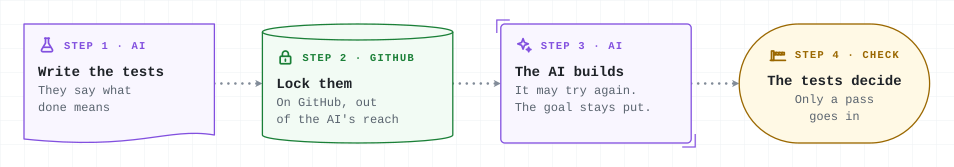
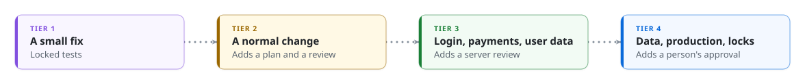

# Tollgate's principles

Tollgate lets an AI write your code, and merges only what works. It keeps 18 rules, in 8 groups. This page explains each rule: what it means, why, how Tollgate does it, and where it stops.

<picture>
  <source media="(prefers-color-scheme: dark)" srcset="diagrams/the-lock-dark.svg">
  
</picture>

Three words first. A **try** is one builder session, then one run of the gate. The **gate** is a program with no AI in it. The driver runs it on your machine after each try. The **store** keeps every signed record in a state folder outside the project, where no AI role can write.

## 1. Plan first

### Rule 1. The analysis comes first, and every fact cites the code

**What it means.** Before the plan, an analyst reads the project and reports how it is built: its structure, entry points, frameworks, similar features, tests, and standards. Each fact is confirmed, with a citation to the code, or marked assumed.

**Why.** A plan written from a guess about the code builds on things that do not exist.

**How Tollgate does it.**

- `driver/task.py` runs the analyst before the plan. The analyst is read-only: its policy denies every edit and every command.
- `gate/analysis.py` reads the analysis and checks each citation, `[path:line]` or `[path::name]`, against the commit it read. A fact whose citation does not exist becomes an assumption.
- The driver keeps the checked analysis and puts it on the plan branch with the plan. The plan writer and the plan reviewers read it.
- `/tollgate:analyze` runs the same analysis by hand, and changes no file.

**Where it stops.** The check proves that a cited line or name exists, not that the claim about it is true. The readiness lens reads the claims, and that is an AI reading.

### Rule 2. Fresh reviewers check the plan before any code

**What it means.** The builder writes a plan for the task. Three reviewers read it, each through one lens, before any code exists. The review repeats for up to 4 rounds.

**Why.** A mistake in the plan costs the least to fix before the code exists.

**How Tollgate does it.**

- `driver/task.py` runs the three lenses in each round: simplicity, fresh reader, and readiness. Simplicity and readiness also read the analysis.
- The builder answers each finding: it fixes it, contests it with evidence, or asks the advisor.
- A round with no blocking or major finding ends the review. After 4 rounds (`MAX_ROUNDS`), the open findings go to the advisor.
- The advisor approves the plan or sends it back. Then the store signs a plan lock in `plans/<task>.json`.
- For tier 2 and higher, the gate fails a try when no plan lock lists its ticket. The setting is `require_plan`, on by default.

**Where it stops.** A reviewer that gives no answer gets one retry. After that, the round does not count as clean. The advisor can approve a plan with open findings.

### Rule 3. An assumption waits for an answer

**What it means.** The plan lists what the request and the analysis do not settle, each as an assumption asked as a question. A plan with an assumption goes to the advisor before it is locked.

**Why.** A builder that guesses an unclear requirement builds the wrong thing well.

**How Tollgate does it.**

- `gate/plan.py` requires the sections Reuse, Risks, and Assumptions. Each assumption ends with a question mark.
- `driver/task.py` sends a plan with assumptions to the advisor, even when the plan checkpoint is off. The advisor answers them and sends the plan back, or approves it as it is.
- The readiness lens reports a part of the plan that rests on an assumed fact and asks nothing about it.

**Where it stops.** The plan writer decides what is unclear. An assumption it does not list is caught only by the readiness lens, or not at all.

### Rule 4. A large request grows one step at a time

**What it means.** A request too large for one plan becomes a roadmap: first the base, then one thin path through every shared rule, then one feature at a time.

**Why.** A plan for a whole product is a guess. Each step should build on code that already works.

**How Tollgate does it.**

- The task skill writes the roadmap, with **Base**, **Skeleton**, **Features**, and **Not yet specified**. `gate/roadmap.py` reads it.
- The roadmap has its own checklist ticket. The driver locks its tests first and checks them after the last task.
- `driver/roadmap.py` runs the tasks in order. A task that does not finish stops the roadmap.
- After the base tasks, the base suite must pass before the skeleton starts. The base suite is five commands under `base` in the settings: the checks run, the tests run side by side, the test setup starts and stops, a wrong setting stops the start, and one request writes one log line.

**Where it stops.** The roadmap and its checks have no passing test. The skill, not code, decides when a request needs a roadmap.

### Rule 5. Each ticket has a checklist, and a must-have item cannot fail

**What it means.** Each ticket lists what done means. Each line is an item. Some items are must-have items.

**Why.** Done must mean the same thing to the builder, the reviewers, and you.

**How Tollgate does it.**

- `gate/tickets.py` reads the ticket. A checklist line looks like `- [C1, must] text`.
- Each must-have item gets a locked test. The gate fails a try when a locked test fails, so no score makes up for a failed must-have item.

**Where it stops.** A checklist can miss what you meant. Only the plan review and you catch that.

## 2. Tests first

### Rule 6. One test for each must-have item, locked before any code

**What it means.** Before the builder starts, the test writer writes one test at a seam for each must-have item, and the store locks it. The AI cannot change a locked test.

**Why.** An AI that cannot make a test pass sometimes weakens the test. When the tests are fixed before the build, done cannot move.

**How Tollgate does it.**

- A reviewer checks the tests through the test fit lens: each fits its item, can fail, and does not take its expected result from the code it tests. The driver sends rejected tests back to the test writer, at most 2 times.
- `Store.freeze` runs the tests once in a clean clone, with main's harness. None may pass yet, except an item marked `keeps behavior`. A test must name its item, such as `test_c1_...`.
- The store writes the lock, `locks/<ticket>.json`, with each locked file and its fingerprint and each locked test, and signs it with the machine key.
- The gate fails any try that changes a locked file, or in which a locked test did not run, was skipped, or failed.
- The policy and the hook refuse an edit of a locked file. pre-commit refuses a commit that changes one.

**Where it stops.** A locked test can be wrong. The store allows one replacement lock for a ticket, but the driver has no step that asks for one. The store runs the tests for a lock on your machine, not in the role's isolation.

## 3. Build from the best try

### Rule 7. Below 70%, try again from the best try

**What it means.** When a try fails, the builder gets the reasons and tries again, starting from its best try so far.

**Why.** Each try should get closer. Starting over loses what worked. Starting from the last try can build on a step backward.

**How Tollgate does it.**

- The driver keeps the commit of the try with the highest score.
- The next try starts from that commit.
- The builder gets the findings of the failed try and the output of each failed check.

**Where it stops.** A score is a lower bound when a check fails, because the reviewers do not run then. So the best try can be one that the reviewers never read.

## 4. The gate judges

### Rule 8. A program with no AI checks every try

**What it means.** The gate checks each try. The AI that built it never grades its own work.

**Why.** A review by the same AI that wrote the code defends the code.

**How Tollgate does it.**

- `gate/gate.py` runs six checks: the lock verifies and matches, a plan lock lists the ticket, every locked file is unchanged, the tier, every check and locked test passes, and a change of tier 2 or more has a passed review.
- It reads the settings from main, never from the try.
- Each reviewer is a separate AI session with no history. A reviewer and the advisor can only read: no edit, no command.

**Where it stops.** The gate reads the test results that the checks write. Code in a change that forges its own test report is out of scope. A reviewer and you are the only defense against that.

### Rule 9. The score is the share of items that pass, and 70% passes

**What it means.** The score is the share of checklist items that passed. A try needs 70% or more, and no failed must-have item.

**Why.** Done should mean the same thing every time.

**How Tollgate does it.**

- An item with a test passes when its tests pass.
- A reviewer decides each other item through the checklist lens. It must name a file and a line, and the driver confirms that the line exists.
- The setting is `pass_score`, 70 by default.

**Where it stops.** A reviewer can be wrong about an item with no test. The 70 is a first guess: no measure has set it.

### Rule 10. A review reads each change from tier 2, and the whole task at the end

**What it means.** A reviewer reads each ticket's change through the review lens from tier 2 up, and the security lens adds a second reading at tiers 3 and 4. After the last ticket, the review lens reads every ticket's change together.

**Why.** A test checks what someone thought to test. A reader finds the rest: a missed requirement, a security hole, a break from the architecture, a missing error case, a slower path, a test gap, or needless complexity.

**How Tollgate does it.**

- `gate/review.py` picks the lenses by tier. A blocking finding fails the try.
- A finding counts only when it points to a file and a line inside the change. The driver drops the rest, so a reviewer cannot fail a try on a guess.
- `driver/task.py` reviews the whole task after the last ticket. A blocking finding goes to the advisor.

**Where it stops.** A tier 1 change gets no review. A reviewer can miss a problem, and a finding inside the change can still be wrong.

### Rule 11. Only the gate says done

**What it means.** A try is done when the gate passes it and the store signs a pass record. Nothing else counts.

**Why.** A role that says "done" is not proof.

**How Tollgate does it.**

- `gate.pass_record` refuses a try with any finding, or a score under `pass_score`.
- The store signs the pass record, `passes/<commit>.json`. It refuses to mark a branch as a ready change, or to merge it, without a verified pass record.
- pre-commit checks the pass record again before a merge into main, and before a push.

**Where it stops.** The pass record is as trustworthy as your machine and your machine key.

## 5. Stop when stuck

### Rule 12. After 3 tries, or the same failure twice, the advisor decides

**What it means.** The builder does not try forever. When it is stuck, the advisor decides: a second AI, or you.

**Why.** A loop with no end burns money and time, and it hides a problem that needs a decision.

**How Tollgate does it.** `driver/stop.py` checks before each try. Each limit is a setting under `stop`.

| Limit | Default |
| --- | --- |
| Tries for one ticket (`attempts`) | 3 |
| The same failure twice in a row | always |
| Minutes for one try (`attempt_minutes`) | 30 |
| Cost of one ticket (`ticket_usd`) | 10 USD |
| Cost of one task (`task_usd`) | 60 USD |

Then the driver asks the advisors in `ai.advisor`, in order. The default is you. The advisor can give one more try with a hint, give one more try with a stronger model, split the ticket, or park it. You answer with `/tollgate:inbox`.

The setting `checkpoints` adds the places where the advisor decides whether the task goes on: `plan` (the approval of the plan), `ticket` (after each ready ticket), and `task` (after the review of the whole task). The default is `["plan", "task"]`. A stop holds: when the task starts again, it stays parked at that checkpoint.

**Where it stops.** No advisor can make the gate pass. A cost stop parks the ticket, and no advisor can lift it. A checkpoint does not count against the AI advisor's limit. An AI advisor decides at most 2 times for one ticket, then only you decide. A split parks the ticket: the driver does not cut it into new tickets.

## 6. Risk sets the checks

### Rule 13. The files give the tier, and you merge tiers 3 and 4

**What it means.** Each change gets a tier from 1 to 4 from the files it touches. A higher tier gets more checks, and you merge the riskiest changes yourself.

**Why.** A typo fix and a change to login code do not carry the same risk.

<picture>
  <source media="(prefers-color-scheme: dark)" srcset="diagrams/tiers-dark.svg">
  
</picture>

**How Tollgate does it.** No AI picks the tier. `gate/tiers.py` works it out from path rules in the settings.

| Tier | When | What it adds | Who merges |
| --- | --- | --- | --- |
| 1 | At most 3 files and 50 lines (`tier1`), and no path rule matches | Locked tests and the checklist review | The store, when `auto_merge` is on |
| 2 | Every other change | An approved plan, and a review through the review lens | The store, when `auto_merge` is on |
| 3 | Paths under `tiers.3`, such as login, payments, or user data | The security lens too | You, with your signed approval |
| 4 | Harness, and paths under `tiers.4` | The same review | You, with your signed approval |

`auto_merge` is off by default. Then you merge every change with `/tollgate:merge`. An approval is signed with your own SSH key and verified against `owners` on main. The machine key is never in `owners`, so it can never approve.

**Where it stops.** A path rule only knows the paths you give it. A risky change in a path with no rule is tier 1 or 2.

## 7. Mistakes become rules

### Rule 14. At most 3 lessons a task

**What it means.** After a task, `/tollgate:retro` shows its numbers and writes at most 3 lessons. Each lesson becomes a ticket: a new test, a new check, a change to a lens, or a stricter rule.

**Why.** The same mistake should not happen twice. More than 3 lessons a task is noise.

**How Tollgate does it.** `driver/retro.py` reads the logs and keeps at most 3 candidates (`MAX_LESSONS`). The retro skill writes each one as a ticket.

**Where it stops.** The retro has no passing test.

### Rule 15. Rules never get looser

**What it means.** Tollgate can make a rule stricter. Only you make a rule looser.

**Why.** A rule that the AI can loosen is not a rule.

**How Tollgate does it.**

- The gate and the store read the settings from main, so a change cannot loosen the rules that check it.
- The settings, the lenses, and the checks are harness. A change to them is tier 4, so it needs your signed approval.
- The home's shared rules reach each project as a branch that you approve and merge (`setup/sync_rules.py`).

**Where it stops.** Nothing checks that a rule change is stricter. Your approval is the check.

## 8. Always

### Rule 16. Code enforces the rules

**What it means.** A rule that is only written in a prompt does not count.

**Why.** An AI can ignore an instruction. It cannot ignore a program that refuses its work.

**How Tollgate does it.** Two layers, and the signed records behind them.

<picture>
  <source media="(prefers-color-scheme: dark)" srcset="diagrams/two-layers-dark.svg">
  
</picture>

- **Claude Code hooks and policies.** `hooks/policy.py` writes a policy for each role: permission rules that deny an edit of a locked file, of the settings, of the key folder, and of the state folder outside the role's copy. `hooks/guard.py` checks each tool call again. It refuses a push, a merge into main, `--no-verify`, and a change to `core.hooksPath`. The plugin runs the same hook in your own session.
- **pre-commit.** `setup/precommit.py` writes the config. `check_locked.py` refuses a commit that changes a locked file. `check_merge.py` refuses a merge into main with no verified pass record, or a tier 3 or 4 merge with no approval, and checks each merge again before a push.
- **Isolation.** The setting `isolation` is `container` by default: the role runs in Docker, with only its own copy mounted, and with no git credentials and no key folder. `sandbox` runs Claude Code with its own sandbox instead.
- **The signed records.** The gate and the store verify every lock and pass record against `signers` on main. They hold even when a role gets past its hook.

**Where it stops.**

- A person who runs `git commit --no-verify` or `git push --no-verify` skips pre-commit and can change main by hand.
- A Bash command such as `python -c` can write a file that a permission rule forbids. The container stops it, because only the copy is mounted. The sandbox should stop it, but this is untested.
- Nobody has tested that a real role obeys its policy.

### Rule 17. Plain words, for people

**What it means.** Everything is written for people to read: docs, comments, commit messages, and diagrams.

**Why.** A rule that nobody understands is a rule that nobody follows.

**How Tollgate does it.**

- Write like a plain-spoken senior engineer talking to someone who knows the project, in the spirit of Simplified Technical English (ASD-STE100).
- One word for each thing. [CONTEXT.md](../CONTEXT.md) lists the words.
- The writing rules are in [lenses/review.md](../lenses/review.md). `/tollgate:docs` writes by them.
- `check_writing.py` runs in pre-commit. It finds the words to avoid, filler, and long dashes. `check_commit_msg.py` checks each commit message.

**Where it stops.** A script finds only some of the rules. The review lens reads for the rest, and only from tier 2.

### Rule 18. Docs move with the code

**What it means.** A change that alters behavior, a command, a setting, an interface, or the architecture updates the README, docs, diagrams, and comments that describe it, in the same change.

**Why.** A doc that describes code that is gone misleads the next reader, and the next AI.

**How Tollgate does it.**

- The plan lists the docs a change alters under Files, and a checklist item covers them. The readiness lens reports a plan that changes behavior and lists no doc.
- The review lens reports a change whose docs still describe the old version, in each ticket and in the whole task.
- `check_writing.py` fails a change that removes a file or a name that a doc still points at: a link, a path in backticks, or `path::name`. It also fails a new link to a file that does not exist. It runs in pre-commit and in the gate, so the builder fixes the doc in the same loop as the code.
- The analyst reads the project's own architecture docs, and confirms each fact against the code.

**Where it stops.** The script proves that a link or a name still exists, not that the sentence around it is still true. The review lens reads for that, and only from tier 2. A reference that was broken before the change is not reported.
